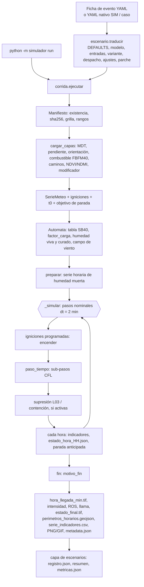

# Informe técnico del motor v4.0 (determinista)

Proyecto: gemelo digital para la prevención y mitigación de incendios en la provincia de San Luis, Argentina.
Fecha del documento: 2026-11-02.
Audiencia: técnica.

## Convenciones

Rutas abreviadas, todas bajo `/home/deina/claude/EXPORT_PROYECTO/`:

| Alias | Ruta |
|---|---|
| `S/` | `Incendios_SanLuis/src/v4.0/src/simulador/` |
| `E/` | `Incendios_SanLuis/src/v4.0/src/incendios_sl/` (capa de escenarios) |
| `Y/` | `Incendios_SanLuis/escenarios/v4.0/` |
| `D/` | `Incendios_SanLuis/docs/v4.0/` |
| `BIT` | `Contexto/informes/reporte_avance.md`, sección 8 (bitácora) |
| `DEC` | `Contexto/informes/decisiones.md` |
| `L/` | `Incendios_SanLuis/` (para rutas `lote_*`, `resultados/`, `datos/`, `test/`) |

Rótulos: **(dato)** verificado leyendo código, configuración o un resultado, con cita ruta:línea; **(inferencia)** deducido de lo que se indica; **(supuesto)** no verificado. Los números de línea son los de los archivos tal como están en este equipo y cambian si se editan. Las cifras recalculadas desde CSV se marcan "recalculado".

---

## 1. Resumen y alcance

**Alcance.** Este informe cubre solo el motor v4.0 determinista: simulador (`S/`), capa de escenarios (`E/`), configuración (DEFAULTS y modelos YAML) y la validación del motor. No trata el ensamble probabilístico ni sus lotes; solo menciona `ensemble` y el modo estocástico para delimitar dónde deja de valer el determinismo (3.11). Quedan fuera por alcance las decisiones D51 y D52 (líneas de trabajo y prerregistro del ensamble, ver 5.2). El contraste con v2.0 y v3.0 se limita a lo imprescindible.

**Qué es el motor.** (dato) Es un autómata celular sobre una grilla de 30 m. Cada celda en combustión acumula avance hacia sus vecinas a lo largo de rayos medidos desde un origen heredado (construcción de Huygens discreta). La velocidad la da Rothermel (1972) en la formulación de Andrews (2018) con los 40 modelos de Scott y Burgan (2005). La forma de la llama es la elipse de Anderson (1983). La salida central es un mapa de tiempos de llegada. Está en numpy vectorizado, sin numba (`Incendios_SanLuis/src/v4.0/requirements.txt:2`). Reemplazó al autómata `incendios_sl.simulation` de v2.0 y v3.0 (`D/14_integracion_sim_v4.md:7-10`).

**Estado en una frase por tema.**

| Tema | Estado | Fuente |
|---|---|---|
| Física de superficie | Implementada y contrastada con valores de referencia de Andrews (2018) en dos casos (GR2 y SH2) | `D/15_verificacion_modelo_fuego_v4.md:26-28` |
| Fuego de copas | (inferencia) No existe: no se halló código de copas en los archivos leídos | `S/` |
| Pavesas, supresión L03, contención, modo estocástico, ensemble | Implementados y apagados en la configuración de referencia (la parada anticipada y los escapes sí están activos, pero son inertes sin contención, 3.10) | `S/config.py:23,66,71,74,100-101,106` |
| Calibración por parámetro (`k_grupo`, regla 3.3c, `factor_waf`, `p_max`) | Ninguna superó su criterio prerregistrado | Sección 5 |
| Barrido de `k_global` (lote_E059, bitácora E058) | Regla prerregistrada dio R3: no se adopta ningún valor | `BIT:1444-1450` |
| Capacidad predictiva | No demostrada: los 10 eventos son vistos | Sección 7 |

**Mensaje principal.** (inferencia, de las secciones 5 y 7) El motor está verificado en su física de superficie y es reproducible, pero su fidelidad frente a eventos reales solo se midió sobre eventos ya vistos. Con `k_global = 1` es más lento que v3.1 (cociente de tiempos mediano 1,82, `BIT:1423`). La configuración de referencia modela propagación libre más barreras del ambiente. Toda la capacidad de mitigación existe en el código y está sin validar.

---

## 2. Arquitectura y flujo de una corrida

### 2.1 Diagrama



### 2.2 Sub-paso interno

(dato, `S/ca/automata.py:450-502`)

```
mientras queda tiempo en el paso nominal:
  _activar_cola(t)        IGNICION -> COMBUSTION, arma avances por enlace (K vecinas)
  _ros_activas(t)         humedad(t), viento(celda,t), Rothermel, k, lluvia,
                          viento+pendiente, elipse, I_B
  R_dir = R(theta_k - rumbo)   ROS hacia cada vecina, theta desde el origen heredado
  celdas nuevas: avance inicial con la forma guardada en el origen (Huygens)
  dt_sub = CFL            avance máximo 0,9 celda; piso 0,1 min
  _propagar_determinista  avance += R*dt; llega si avance >= d; barreras; re-anclaje
  [_spotting]             solo si spotting.activo
  t += dt_sub ; _quemadas_completas   COMBUSTION -> QUEMADO
```

### 2.3 Etapas de una corrida

| # | Etapa | Qué hace el código | Cita |
|---|---|---|---|
| 1 | Entrada | Dos puertas. (a) `scripts/correr_escenario.py` toma una corrida de `Y/corridas/*.yaml` con `evento`, `caso` o `sim`. (b) `python -m simulador run --config` carga un YAML SIM y llama a `ejecutar` (dato) | `Incendios_SanLuis/src/v4.0/scripts/correr_escenario.py:37-61`; `S/__main__.py:26-31` |
| 2 | Traducción ficha a cfg | `traducir` exige exactamente una fuente. Orden: DEFAULTS, modelo (`modelo_v3` por defecto), entradas, variante, campos sueltos, despacho, `ajustes`, `parche`; cada paso pisa al anterior. Activa la parada en la cicatriz con `evento` y `caso` (dato) | `E/escenario.py:196-232, 283-287, 392` |
| 3 | Insumos del evento | t0 es la hora de la hipótesis `h`; fin es `fin_simulacion_utc` o t0 + `horas` (lo menor). Convierte la meteorología de v3.0 al CSV estándar (viento vectorial m/s por 3,6, huecos de hasta 3 h interpolados). Genera el combustible pre-evento. Desplaza la ignición a la celda combustible más cercana si cae en no combustible o fuera de la grilla (dato) | `E/eventos.py:446-458, 117-136, 266-307, 461-499, 509-534` |
| 4 | Validación de entradas | El manifiesto comprueba existencia, sha256, grilla, dtype, nodata, rango y códigos de combustible conocidos. La serie meteorológica debe ser horaria, sin huecos y con huso. Cualquier diferencia detiene la carga (dato) | `S/io/manifiesto.py:121-142, 144-168, 196-219`; `S/corrida.py:84-85` |
| 5 | Carga de capas | MDT, pendiente, orientación (361 = plano) y combustible. Rasteriza caminos, viviendas y red eléctrica con `all_touched`. Lee NDVI/NDMI del mes, NDVI de verano y el modificador de carga (recortado a [0, 2]). Suma `barreras.extra` (dato) | `S/io/capas.py:64-160`; `S/corrida.py:95-100` |
| 6 | Meteorología, ignición, t0 | `t_inicio` o la primera ignición. Toda `hora_ignicion` debe llevar huso. `parada.superficie_observada` fija `superficie_objetivo_ha` desde el perímetro observado (dato) | `S/corrida.py:101-123, 28-80` |
| 7 | Autómata | Arma estado, tabla SB40, `factor_carga`, humedad viva, curado, campo de viento y arrays de la banda activa. `preparar` calcula la serie horaria de humedad muerta (dato) | `S/corrida.py:135-137`; `S/ca/automata.py:142-286` |
| 8 | Bucle `_simular` | Pasos nominales `round(duracion*60/dt)`. En cada paso: igniciones programadas, emisión horaria, parada anticipada, `paso_tiempo`, L03, contención, tope por superficie (dato) | `S/corrida.py:217-338` |
| 9 | Productos | `hora_llegada_min.tif` (float32, minutos desde t0, NaN = no arde), `intensidad_max_kw_m.tif`, `ros_max_m_min.tif`, `longitud_llama_max_m.tif`, `estado_final.tif`, `perimetros_horarios.geojson` (WGS84), `serie_indicadores.csv`, `estado_hora_HH.json`, `descripcion_hora_HH.txt`, PNG y GIF (dato) | `S/outputs/geo.py:26-78`; `S/corrida.py:148-165, 283-291` |
| 10 | `metadata.json` | Versión de código, semilla, modo, dt, vecindad, grilla, igniciones, parámetros completos, sha256 de insumos, `sub_pasos`, `motivo_fin`, `parada_suspendida` (dato) | `S/corrida.py:180-210` |
| 11 | `registro.json` | Lo escribe la capa de escenarios, no el simulador: `run_id`, `motivo_fin`, `segundos`, `sub_pasos`, `ha_quemadas`, `entradas`, `config`. Luego puede escribir `metricas.json` (dato) | `E/resumen.py:97-120`; `scripts/correr_escenario.py:63-75` |

Observaciones.
- (dato) Los polígonos horarios y los indicadores se reconstruyen desde `t_llegada` y `t_fin` (`afectada = t_llegada <= t`). No se guardan estados por hora (`S/outputs/indicadores.py:31-37`).
- (inferencia) Si `dt_min` no divide a 60 min, la condición `abs(t_min - hora*60) < 1e-6` de `S/corrida.py:280` no se cumple en las marcas horarias y se omiten salidas horarias. Con `dt_min = 2` no ocurre.
- (dato) Motivos de fin: `horizonte`, `extinguido`, `sin_avance`, `contenido`, `superficie_observada` (`S/ca/contencion.py:64-72`).

### 2.4 Configuración por capas

(dato) La configuración se arma por fusión recursiva (`fusionar`, `S/config.py:110-117`): los diccionarios se mezclan y cualquier otro valor, incluidos listas y `null`, reemplaza al anterior. Por eso `huygens: null` en `Y/modelos/sim_v4_original.yaml:193` anula el diccionario completo. Orden efectivo (`E/escenario.py`):

1. DEFAULTS (`S/config.py:15-107`).
2. Modelo (`escenario.py:232`), elegido por `modelo` o por la variante (`escenario.py:215`).
3. Entradas según el modo: ficha de evento (`:244`), `caso.yaml` y variante del caso (`:256-260`) o YAML `sim` (`:268`). Pisan al modelo.
4. Campos sueltos (`:276-316`): `barreras` y `contencion` on/off, `parar_en_cicatriz`, `k_grupo`, `k_codigo`, `k_global`, `factor_waf`, `humedad`, `viento`, `semilla`, `ensemble`, `mitigacion`, `figuras`.
5. Preset de despacho y bloque `combate` (`:319-388`).
6. `ajustes`, fusionado en `parametros` (`:391`).
7. `parche`, fusionado en el cfg completo (`:392`).
8. `validar_cfg` (`:395`).

(dato) La corrida por `app/motores/sim_adaptador.py` sigue otro flujo: `fusionar(modelo, esc)` y luego sobre DEFAULTS (`sim_adaptador.py:296-308`); su modelo por defecto es `sim_v4_original` (`sim_adaptador.py:13-15`).

---

## 3. El motor

### 3.1 Grilla y tiempo

- (dato) EPSG:5345, 30 m, 1672 columnas por 1671 filas, `xmin` 3 513 060, `ymax` 6 417 900 (`Incendios_SanLuis/datos/inputSimulacion/sim_v4/manifiesto_datos.yaml:3-9`). Una corrida real lo confirma (`L/resultados/v4.0/SL-2024-LASLAGUNAS/prueba_rapida_v4_20261028-0955/metadata.json`).
- (dato) Una `grilla` de ventana debe caer sobre vértices de la grilla base (`S/io/grilla.py:99-112`).
- (dato) Vecindad 8 (Moore) por defecto, o 16 con saltos de caballo (`S/config.py:22`; `S/ca/estados.py:36-48`). Distancias 30, 42,43 y 67,08 m (`S/ca/estados.py:16-19`).
- (dato) Paso nominal `dt_min = 2`, es decir 30 pasos por hora (`S/config.py:21`; `S/corrida.py:237`).
- (dato) Sub-pasos CFL: `dt_sub = restante` si `R_max*restante <= cfl*d_min`; si no, `dt_sub = max(cfl*d_min/R_max, dt_sub_min)`, con `cfl = 0,9` y `dt_sub_min = 0,1` min (`S/ca/automata.py:454, 486-489`; `S/config.py:41-42`). A 30 m el frente no avanza más de 27 m por sub-paso.
- (inferencia) El piso de 0,1 min deja de garantizar el CFL cuando R_max supera 27/0,1 = 270 m/min.
- (dato) La llegada se interpola dentro del sub-paso (`t_lleg = (t - crédito) + fracción*dt_eff`) y no se acota al borde (`S/ca/automata.py:625-627`).
- (dato) Medido: 610 sub-pasos para 180 pasos nominales en una corrida de 6 h (`prueba_rapida_v4_20261028-0955/registro.json`); 7092 sub-pasos en 59,9 h simuladas en Las Lagunas h1 (`L/resultados/v4.0/SL-2024-LASLAGUNAS/SL-2024-LASLAGUNAS-20240918-h1-SNMF-barreras/registro.json`), unos 3,9 por paso nominal.

**Estados** (dato, `S/ca/estados.py:26-30`): `NO_COMBUSTIBLE(0)`, `COMBUSTIBLE(1)`, `IGNICION(2)`, `COMBUSTION(3)`, `QUEMADO(4)`. `IGNICION` espera `ignicion_delay_min` (0 por defecto) y pasa a `COMBUSTION` en `_activar_cola` (`S/ca/automata.py:342-352`; `S/config.py:39`). Una celda pasa a `QUEMADO` cuando cumplió la residencia tau = 384/sigma y no le quedan vecinas pendientes (`S/ca/automata.py:679-690`; `S/physics/rothermel.py:169`).

### 3.2 Combustible

- (dato) `S/fuel/sb40.py:27-80` transcribe 45 filas: 5 no combustibles (91, 92, 93, 98, 99) y 40 combustibles (GR1-9, GS1-4, SH1-9, TU1-5, TL1-9, SB1-4). Columnas: cargas 1 h, 10 h, 100 h, herbáceo vivo y leñoso vivo (t/ac); SAV; profundidad (ft); Mx muerto (%); calores; bandera `dinamico`. SAV de 10 h (109) y 100 h (30) fijos (`sb40.py:83-84, 124-125`). Un modelo es combustible si suma de cargas > 0 y profundidad > 0 (`sb40.py:131`).
- (dato) El ráster de combustible son códigos FBFM40 `int16` del manifiesto o de un archivo que lo reemplaza (`S/io/capas.py:64-100`; `S/corrida.py:95`). Códigos desconocidos se tratan como no combustibles con aviso (`sb40.py:134-148`).
- (dato) Los caminos con ancho mayor o igual a la resolución quedan `NO_COMBUSTIBLE`; los más angostos reducen la carga con `factor_carga = 1 - ancho/res`. El `modificador_combustible` multiplica la carga (0 equivale a cortafuego) (`S/ca/automata.py:194-201`). En la física, `w = T.w[im]*factor_carga` (`automata.py:426`).
- (dato) El herbáceo se parte en muerto y vivo con la fracción de curado (`S/physics/rothermel.py:81-83`).
- (dato) En modo `evento`, el mapa pre-evento se genera con `generar_sb40.generar`: MapBiomas Col. 3 del año anterior, MDT, NDVI/NDMI mediana de enero a marzo y terciles de `umbrales_ndvi.csv` (`E/eventos.py:266-307`; `S/fuel/generar_sb40.py:57-82`). Las herbáceas con NDMI > 0,15 pasan a GR6 (`generar_sb40.py:15-28, 67-79`). La regla 3.3b es la vigente en `modelo_v3` y resta a las leñosas la anomalía interanual del NDVI. La 3.3c convierte pasturas en GR1 y no se adoptó (`Y/modelos/modelo_v3.yaml:10`; `generar_sb40.py:31-54, 80-81`; `BIT:1124`).
- (dato) Solo 14 de los 40 modelos pueden aparecer en un mapa generado: GR1, 2, 3, 4, 6, 7; GS1, 2; SH2, 5, 7; TU1, 5; TL8 (`generar_sb40.py:18-19`).

### 3.3 Viento

- (dato) Viento a 10 m, dirección DESDE donde sopla. Interpolación lineal en T y HR y por componentes (u, v) en el viento. La lluvia de una fila es la de la hora que termina en ese instante (`S/io/meteo.py:1-12, 66-82`).
- (dato) Tres fuentes de campo (`S/physics/viento.py:206`):
  - `externo`: GeoTIFF u, v por hora.
  - `windninja`: biblioteca de campos unitarios de v3.0 (72 direcciones cada 5 grados, 100 m). Se escala con la velocidad, se interpola entre direcciones vecinas y se muestrea bilinealmente (`viento.py:17-24, 142-170`).
  - `serie` (defecto desde D41): viento uniforme por un factor topográfico `f = 1 + 0,5*tan(theta)*cos(orientación - dir_desde) + 0,3*clip(relieve/100, -1, 1)`, acotado a [0,7; 1,3]. No cambia la dirección (`viento.py:47-53, 172-179`; `Y/modelos/modelo_v3.yaml:14-17`).
- (dato) Factor 10 m a 20 ft: `factor_10m_20ft = 0,87`. V.4 tenía 1/0,87 por error (`viento.py:36, 53`; `D/15_verificacion_modelo_fuego_v4.md:33`). Viento a media llama `U_mf = v_kmh * 54,68 * 0,87 * WAF[modelo]` (`S/ca/automata.py:428`).
- (dato) WAF sin dosel: `1,83/ln((20 + 0,36*delta)/(0,13*delta))` con delta la profundidad del lecho en ft (delta >= 0,05); TU = 0,3 y TL = 0,2 fijos; 0 en no combustibles (`viento.py:40-42`; `sb40.py:173-180`). `factor_waf` multiplica el vector completo (`automata.py:210-211`).

Límites de viento efectivo (dato, `S/physics/rothermel.py:160-166, 198-205`):

| `limite_viento` | Qué hace | Dónde |
|---|---|---|
| `rothermel_1972` | `U = min(U, 0,9*I_R)` sobre el viento a media llama, antes de combinar con la pendiente. Modo de `sim_v4_original` | `rothermel.py:162-163`; `Y/modelos/sim_v4_original.yaml:10` |
| `andrews_2013` (defecto) | `U_lim = 96,8*I_R^(1/3)`. `combinar_viento_pendiente` calcula `U_eff` desde phi_eff = phi_w + phi_s (suma vectorial). Si `U_eff > U_lim` reemplaza phi_eff por `C*U_lim^B*(beta/beta_op)^-E` y recalcula R_max | `rothermel.py:164-165, 198-205`; `S/config.py:38` |
| `ninguno` | Sin tope | `rothermel.py:161` |

(dato) La elipse usa el `U_eff` ya limitado, `LB(U_eff/88)` (`S/ca/automata.py:441-442`).

### 3.4 Humedad

**Combustible muerto** (`metodo_muerto: retardo`, defecto).
- (dato) EMC de Simard (1968) con coeficientes NFDRS en grados F, tres tramos según HR, recorte a [1 %, 35 %] (`S/physics/humedad.py:48-68`; `modelo_v3.yaml:20-21`). `emc: v4_original` reproduce los coeficientes erróneos de V.4 y el piso de 2 % (`humedad.py:56-60`).
- (dato) Las clases de 1, 10 y 100 h siguen al EMC con relajación exponencial horaria `m[i] = m[i-1] + (EMC[i] - m[i-1])*(1 - exp(-1/tau))`, tau = 1, 10, 100 h. La serie arranca en equilibrio con la primera fila del CSV (`humedad.py:189-196`). El informe 15 lista esa inicialización como P10 pendiente (`D/15_verificacion_modelo_fuego_v4.md:104`).
- (dato) Lluvia: suma 3,0, 1,5 y 0,5 puntos por mm a 1, 10 y 100 h (dividido por 100), con tope único de 35 % (`humedad.py:79-83, 197-200`). La extinción por lluvia de 24 h está desactivada (`lluvia_24h_mm_extincion: null`, `modelo_v3.yaml:22`; `automata.py:294-301, 438-439`).
- (dato) La humedad muerta es un escalar por instante, uniforme en el dominio. Solo la de 1 h recibe aditivos por celda: +0,02 en TU y TL (sombra de dosel) y +0,01 en laderas con pendiente > 5 grados y orientación entre 120 y 240 grados (`automata.py:228-231, 288-292, 434`).
- (dato) Alternativas: `ffmc_vanwagner` y `fija` (`humedad.py:140-178, 201-210`).
- (dato) Humedad de extinción Mx de la tabla (12 a 40 %), reemplazable por `mx_grupo` o `mx_codigo` (`sb40.py:165-167`; `automata.py:213`). La celda se declara extinguida si la humedad muerta ponderada `Mf_d >= Mx` (`rothermel.py:170-171`).

**Combustible vivo (LFMC) y curado.**
- (dato) `viva_metodo: lineal` (defecto): `M(%) = clip(120 + 250*NDMI, 50, 250)`; NDMI inválido equivale a -0,1; sin NDMI, `viva_defecto = 0,60` (`humedad.py:91-94, 116, 219-221, 234-246`). `minmax` (v3.0) escala NDMI entre [ndmi_min, ndmi_max] a [lfmc_min, lfmc_max]; `fija` da un valor único (`humedad.py:224-251`). Los parámetros están marcados "a calibrar" en el código (`humedad.py:25-31`).
- (dato) Curado del pasto: `curado = clip(1,5*(1 - NDVI_mes/max(NDVI_verano; 0,05)), 0,3; 1)`; sin esos índices, regla de Scott y Burgan `clip((1,2 - M_herb)/0,9, 0, 1)` (`humedad.py:254-264`; `automata.py:219-224`). Solo se aplica a modelos `dinamico` (`automata.py:431-432`).

### 3.5 Propagación

- (dato) `rothermel()` implementa seis clases (1 h, 10 h, 100 h, herbáceo muerto, herbáceo vivo, leñoso vivo): ponderaciones, sigma característica, beta y beta_op, velocidad de reacción I_R, humedad de extinción del vivo (Albini), R0 y coeficientes C, B, E. phi_s = 5,275*beta^-0,3*tan^2(theta). tau = 384/sigma (`S/physics/rothermel.py:60-171, 137, 168-169`).
- (dato) La pendiente empuja ladera arriba. Se suman los vectores phi_w y phi_s, `R_max = R0*(1 + phi_eff)` y se obtiene el rumbo de la cabeza (`rothermel.py:175-205`). `k` multiplica R0 (y con él la intensidad de Byram) pero no phi (`automata.py:436-437`).
- (dato) Elipse: `LB = 0,936*exp(0,2566*U) + 0,461*exp(-0,1548*U) - 0,397` con U en mi/h, recortada a [1, 8]; `e = sqrt(LB^2 - 1)/LB`; `R(theta) = R_max*(1 - e)/(1 - e*cos(theta))` (`S/physics/elipse.py:12-26`). Intensidad de Byram `I_B = I_R*tau*R/60` (BTU/ft/s) por 3,4613 a kW/m; llama `L = 0,45*I_B^0,46` ft convertido a m (`rothermel.py:209-215`).
- (dato) Huygens por origen heredado (`automata.py:1-25, 603-634`):
  - Cada celda activa tiene K enlaces con `avance` acumulado, `theta_k` y `d_k` medidos desde su origen heredado.
  - Cada sub-paso: `avance += R(theta_k - rumbo)*(dt_sub + crédito)`. La vecina se enciende cuando `avance >= d_k` y `R_dir > 0`; la llegada se interpola.
  - Una celda nueva hereda el origen del padre; su avance inicial es `d_self*R_o(theta_k)/R_o(theta_self)` con el rumbo y la excentricidad guardados al anclar (P3). Con `huygens: null` (V.4) usa la forma actual (`automata.py:475-485, 504-516`; `D/15_verificacion_modelo_fuego_v4.md:35`).
  - Re-anclaje si se cumple alguna condición (`automata.py:554-572`): distancia al origen mayor que `radio_huygens_m` (300 m); cambia el modelo de combustible; cambia `factor_carga`; hay camino en la celda emisora, receptora o intermedia; el rumbo de cabeza del padre difiere más de 15 grados o su excentricidad más de 0,05.
- (dato) Llevar el radio de Huygens a 1000 y 3000 m no cambió el resultado en 18 igniciones (`BIT:1228-1249`). (inferencia) Probablemente los otros criterios re-anclan antes de los 300 m; no se verificó.
- (dato) Factores `k`: `k_global * (k_codigo si está, si no k_grupo, si no 1)` por modelo; todos valen 1,0 en `modelo_v3` (`sb40.py:169-171`; `modelo_v3.yaml:35`).

### 3.6 Extinción

(dato) `ext` significa R0 = 0 por humedad (`Mf_d >= Mx`) o por lluvia. En `reversible` (defecto) la celda sin vecinas pendientes y con `ext` queda latente en `COMBUSTION` y retoma cuando baja la humedad. En `definitiva` (V.4) pasa a `QUEMADO` (`S/ca/automata.py:679-690`; `S/config.py:47`). `n_latentes` lo consulta la parada (`automata.py:685`; `S/corrida.py:355-356`).

### 3.7 Pavesas

(dato) `spotting.activo: false` por defecto. Por celda activa y sub-paso: `p = p_max*(1 - exp(-I_B/I_ref))*min(U/30, 1)`, con `p_max = 0,05` e `I_ref = 3000` kW/m, ajustada al sub-paso como `1 - (1-p)^(dt_sub/Delta_t)` (P8). A lo sumo `max_por_paso = 20` candidatas. Distancia lognormal con mediana `150*(1 + U/20)` m y sigma_log 0,6; dirección a favor del viento más N(0, 15 grados). La celda destino, si es combustible, se enciende y pasa a ser su propio origen (`S/ca/automata.py:654-677`; `S/config.py:66-68`).
- (dato) Usa el viento de la serie a 10 m, no el campo de WindNinja ni el topográfico (`automata.py:659`).
- (inferencia) Toma las primeras 20 candidatas en el orden del array de la banda activa, no una muestra aleatoria.
- (dato) Una prueba de 438 corridas no las adoptó (`BIT:1292-1326`).

### 3.8 Caminos y barreras

- (dato) `ANCHO_POR_TIPO`: pavimentado 8, ripio 7, tierra 5, huella 3, cortafuego 10 m; gana el más ancho. Las celdas con camino son combustibles con carga reducida y re-anclan el origen (`S/io/capas.py:15, 98-119`; `S/ca/automata.py:196-198`).
- (dato) El cruce se decide al alcanzar una vecina con camino (`barreras.modo: probabilistico`). La llama en la dirección del enlace es `L(theta) = L_cabeza*(R(theta)/R_max)^0,46`. `P(cruce) = (sigma(x) - sigma(0))/(1 - sigma(0))` con `sigma(x) = 1/(1 + exp(-beta*(x - lambda)))`, `x = L/W`, lambda = 1, beta = 4. W es el ancho máximo entre receptora e intermedias (`automata.py:108-122, 575-609`).
- (dato) El sorteo es un hash por (semilla, fila, col, enlace, hora). Un enlace bloqueado queda bloqueado hasta la hora siguiente y su avance se fija en la distancia (`automata.py:592-609, 621`).
- (dato) `umbral_tipo` (V.4) compara la llama de cabeza con el umbral del tipo de camino y mira solo la receptora (`automata.py:588-590`).
- (dato) `barreras.extra` suma líneas con `ancho_m` (`S/io/capas.py:162-199, 150-157`).

### 3.9 Supresión y contención

**Supresión L03** (apagada por defecto). (dato) Cada dotación llega en `llegadas_min` y produce 500 m/h. El presupuesto se gasta contra celdas de frente cuya llama local es menor que 2,4 m, de menor a mayor llama. Una celda contenida cuesta `res` metros y anula sus vecinas pendientes. El presupuesto no gastado no se acumula (`S/ca/supresion.py:1-46, 52-80`; `S/config.py:71-72`).

**Contención por combate** (apagada por defecto; la activan variantes como `local`).
- (dato) Tasa de línea `fijo` o `snmf`: `min(kappa(A)*a*A^b, tasa_max)` con a = 17,3, b = 0,36, kappa = 10, quiebre en 3000 ha y gamma = 0,62. El presupuesto se acumula hasta `acumular_max_h` (8 h) (`S/ca/contencion.py:84-95, 388-426`; `S/config.py:74-95`).
- (dato) Candidatas: celdas del perímetro exterior con intensidad menor que el umbral de sostén (1700 kW/m, o 3500 con medio aéreo); elección contigua con ancla y flancos (`contencion.py:166-201, 246-271, 435-455`).
- (dato) La línea actúa dentro del paso con `filtro_enlaces` (`contencion.py:332-350`; `automata.py:369-370, 526-527`).
- (dato) Escapes: una vez por hora, una celda contenida cuya intensidad potencial supera 3500 kW/m escapa con `p_escape_hora = 0,5` (hash) (`contencion.py:492-513`).
- (dato) Se evalúa después de cada paso nominal, no de cada sub-paso (`S/corrida.py:321-325`).

### 3.10 Condiciones de parada

(dato, `S/corrida.py:299-319, 217-243, 347-357`) La parada anticipada se evalúa cada hora.
- Candidata `contenido`: frente contenido, sin ignición pendiente y con contención activa.
- Candidata `sin_avance`: `horas_sin_avance` (12) horas sin nuevas celdas afectadas.
- Se suspende por `escapes` posibles, por pavesas activas con celdas en combustión y, solo para `sin_avance`, por latentes hasta `latentes_max_h` (24 h). Las horas suspendidas van a `metadata.json.parada_suspendida`.
- `escapes: potencial` (el que fija `modelo_v3`) solo suspende si alguna celda contenida puede superar el umbral con la meteorología restante; `v3` suspende siempre que haya contenidas con vecinas libres (`contencion.py:520-537`; `modelo_v3.yaml:51-53`). En la ablación E035, `potencial` dio áreas idénticas en 51/51 con -52 % de cómputo en corridas con combate (`BIT:857-858`).
- Tope por superficie: con `parar_en_cicatriz` (activo por defecto con `evento` y `caso`) la corrida termina en el sub-paso en que la superficie iguala la observada y emite la hora parcial (`S/corrida.py:326-329`; `E/escenario.py:283-287`).
- (inferencia) Sin contención, `escapes` y `contenido` son inertes: `parar_contenido` exige contención (`S/corrida.py:255`) y `escape_posible` solo se llama con ella (`corrida.py:351`).

### 3.11 Determinismo y semillas

- (dato) `modo: determinista` y `semilla = 42` por defecto (`S/config.py:23-24`). El `rng` se crea con esa semilla y solo se consume en el modo estocástico y en las pavesas (`automata.py:153, 644, 665-669`).
- (dato) Con pavesas apagadas y `ensemble.n = 0`, lo que parece aleatorio en el determinista es un hash. Con pavesas activas, el resultado depende de `self.rng` sembrado (la corrida sigue siendo reproducible con la misma semilla, pero deja de ser función solo de los insumos); con `ensemble.n > 0` el modo pasa a estocástico (`S/corrida.py:126-129`). El cruce de barreras usa `u01(semilla, fila, col, enlace, hora)`, mezcla tipo splitmix64 independiente del orden de procesamiento, con `barreras.semilla = 20261015` (`automata.py:89-100, 604`; `config.py:61`).
- (dato) La contención usa el mismo hash con `semilla + miembro` y `default_rng([semilla, 7, clase])` para el medio aéreo (`contencion.py:307, 370, 500`). `semilla` de la corrida se copia a `barreras.semilla` y `contencion.semilla` (`E/escenario.py:302-304`).
- (inferencia) Con contención y pavesas apagadas, la única fuente pseudoaleatoria del determinista es el hash de barreras.
- (dato) Existen las pruebas `test_reproduce_v4_original_exacto` y `test_reproducible_con_semilla` (`L/test/v4.0/test_fisica_v4.py:144`; `L/test/v4.0/test_contencion.py:133`). El informe 15 declara tiempo de llegada idéntico a V.4 y 0 celdas distintas en cinco rásteres para La Aguada (`D/15_verificacion_modelo_fuego_v4.md:55-59`). No se volvieron a ejecutar.
- (supuesto) Igualdad bit a bit entre versiones de numpy o plataformas.

### 3.12 Costo y memoria

El tiempo `segundos` de `registro.json` mide `traducir` más `ejecutar` (carga, sha256 si no se omite, simulación y figuras) sin separarlos (dato, `scripts/correr_escenario.py:43, 62`).

| Medida | Valor | Fuente |
|---|---|---|
| Base `libre`, 51 igniciones (9 eventos menores) | 3037 s en total, unos 60 s por corrida (cálculo 3037/51) | `BIT:851` |
| Mediana por corrida; rango entre eventos | 60 s; 23 s (Mesilla) a 209 s (Las Lagunas) | `BIT:1339` |
| Las Lagunas, variante `barreras` | 147,8 s con 7092 sub-pasos (59,9 h); 205,1 s con 8767 sub-pasos (74,6 h, regla 3.3b) | `BIT:922`; `registro.json` de `SL-2024-LASLAGUNAS-20240918-h1-SNMF-barreras` y `...-3.3b` |
| Prueba de humo, 6 h | 36,2 s; 610 sub-pasos; 152,82 ha | `prueba_rapida_v4_20261028-0955/registro.json` |
| Costo relativo por opción (ablación E035) | WindNinja +66 %; barreras +6 %; combate `local` +181 %; FFMC +16 %; 3.3b -33 % | `BIT:852-858` || lote_E059 (bitácora E058): 50 corridas | 3 h 46 min de reloj con 5 procesos; cómputo sumado 18,2 h (estimado ~11 h); máximo por corrida 107,7 min | `BIT:1436` |
| Renca `k_global = 3` | 2258,8 s (SIGKILL), repetida en 1336,7 s | `BIT:1439` |
| Chilcas `k_global = 4` | 228,2 s (SIGKILL), repetida en 197,1 s | `BIT:1439` |
| Las Lagunas libre, 4 corridas del lote | 3563 a 6287 s por corrida (5 procesos a la vez) | `L/resultados/v4.0/SL-2024-LASLAGUNAS/SL-2024-LASLAGUNAS-h0-alt0-libre-E059k*/registro.json` |

- (dato) Los segundos de lotes distintos no son comparables entre sí (figuras, procesos simultáneos): `BIT:933`.
- (dato) El "-33 %" de la regla 3.3b se midió en el conjunto de la ablación E035, no en Las Lagunas. En Las Lagunas la regla 3.3b duró más (205,1 s contra 147,8 s) porque simuló 74,6 h en lugar de 59,9 h. No hay contradicción, pero los porcentajes de la fila "Costo relativo" no se transfieren a un evento puntual. (inferencia) Por hora simulada esos dos registros dan 2,75 s/h (3.3b: 205,1/74,6) y 2,47 s/h (`barreras`: 147,8/59,9), recalculado.
- (inferencia) El costo crece con el número de sub-pasos y con el tamaño de la banda activa (`automata.py:415-447, 611-634`). Cada activación concatena los arrays de la banda (`automata.py:382-400`), por lo que copia la banda; este punto no está medido.
- (dato) La bitácora no registra la memoria (RSS) de una corrida. Solo registra un lote en el que 2 corridas murieron con código -9, con unos 11,6-11,8 GB en uso de 13,9 GB con 5 procesos simultáneos; la causa se anotó como "inferencia sin verificar" y las repeticiones con 2 procesos terminaron bien (`BIT:1439, 1455`).
- (inferencia, por conteo de arrays, no medido) Sobre 2,79 millones de celdas: unos 112 MB en diez arrays float32 de estado, 45 MB en origen y conteos, 100 MB en capas auxiliares del autómata y 90 MB en `Capas`; del orden de 0,3 a 0,4 GB sin intérprete, librerías ni figuras (`automata.py:190-277`; `S/io/capas.py:36-61`).
- (inferencia) Conciliación: la estimación de 0,3-0,4 GB es por corrida y solo cuenta arrays; el 11,6-11,8 GB medido es el uso de todo el equipo con 5 procesos (unos 2,3 GB por proceso si se reparte parejo, supuesto de reparto). La diferencia de un factor 6 a 8 entre ambos valores, por proceso, queda sin explicar: puede deberse a intérprete, librerías, figuras, copias de arrays al activar celdas (punto anterior) u otros procesos del sistema. No se midió.

### 3.13 Interfaz de línea de comandos y módulos auxiliares

| Módulo | Qué hace | Cita |
|---|---|---|
| `S/__main__.py` | `python -m simulador` con cuatro subcomandos: `validar` (valida el manifiesto de datos; `--sin-sha` omite el sha256), `run --config <yaml>` (corre un YAML SIM nativo), `caso <carpeta>` (corre y evalúa un caso del conjunto de prueba; `--variante V` elige una, `--todas` corre todas; `--sin-sha`) e `informe <carpeta>` (reconstruye `evaluacion.md` con la corrida más reciente de cada variante). (dato) | `S/__main__.py:105-112` |
| `S/rutas.py` | Resuelve las raíces: `INCENDIOS_SL_REPO`, `INCENDIOS_SL_RESULTADOS` (por defecto `resultados/v4.0`), `INCENDIOS_SL_SIM_DATOS` e `INCENDIOS_SL_PROCESADOS`. `raices_permitidas()` devuelve repositorio, carpeta de datos y, si está definida, la de procesados. La política: toda ruta de un escenario debe quedar dentro de esas raíces o `resolver_valor` lanza `ValueError`. `relativa()` guarda en los metadatos rutas relativas, sin rutas de la máquina. (dato) | `S/rutas.py:21-63`; `S/config.py:129-141` |
| `S/sintetico.py` | Escenarios sintéticos para pruebas: terreno plano o inclinado, combustible homogéneo (código 102 por defecto), meteorología constante (`grilla_sintetica`, `capas_sinteticas`, `meteo_constante`, `config_sintetica`, `correr_sintetico`, `simular_sintetico`). No interviene en corridas reales. (dato) (supuesto) lo usan las pruebas de simetría y de física; no se rastreó cada uso | `S/sintetico.py:14-78` |
| `S/evaluacion/informe.py` | `evaluar_corrida` compara una corrida con el perímetro observado principal y los alternativos (incluida la comparación a igual superficie) y `escribir_informe` genera `evaluacion.md` con tabla, figura comparativa y discusión por plantilla. Es la evaluación de los casos del conjunto de prueba, distinta de las métricas V1 a V3 y F1 a F5 de 7.2. (dato) | `S/evaluacion/informe.py:17, 74` |
| `S/outputs/figuras.py`, `S/outputs/descripcion.py` | `Dibujante` genera `mapa_hora_HH.png`, `isocronas_final.png` y la animación (`figura_hora`, `figura_final`); el recuadro por defecto es `recuadro_automatico` sobre la cicatriz o el perímetro observado. `descripcion_hora` redacta `descripcion_hora_HH.txt` desde el indicador de la hora. (dato) | `S/corrida.py:169-178, 290`; `S/outputs/descripcion.py:13` |
| `S/fuel/generar_sb40.py` | Genera el mapa de combustible pre-evento (modo `evento`); ver 3.2. No lo llama el simulador sino la capa de escenarios (`E/eventos.py:266-307`). (dato) | Anexo B |

---

## 4. Opciones de configuración

### 4.1 Fuentes y modos

| Capa | Dónde | Qué fija |
|---|---|---|
| DEFAULTS | `S/config.py:15-107` | Todos los parámetros. `cargar_config` (`:120-126`) fusiona un YAML nativo sobre DEFAULTS |
| Modelo | `Y/modelos/modelo_v3.yaml`, `sim_v4_original.yaml` | YAML parcial sobre DEFAULTS (`E/escenario.py:148-151`) |
| Ficha de evento | `Y/eventos/<id>.yaml` | Fechas, hipótesis de hora, puntos de ignición, fin, `cobertura_anio`, `combate`. No fija parámetros físicos |
| Escenario (corrida) | `Y/corridas/*.yaml` | Campos de `CAMPOS` (`escenario.py:110-113`), `ajustes`, `parche` |
| Línea de comandos | `scripts/correr_escenario.py:87-91` | Solo `--escenario`, `--archivo`, `--sin-sha`, `--solo-simular`, `--silencioso` |
| Entorno | `E/config.py` | `INCENDIOS_SL_ESCENARIOS`, `_RESULTADOS`, `_RAIZ`, `_REPO`, `_DATOS`, `_INPUT`, `_PROCESADOS`, `_CRUDOS` |

(dato, `E/escenario.py:200-272`) Una corrida tiene exactamente una fuente:

| Modo | Qué lee | `parar_en_cicatriz` auto | Validación |
|---|---|---|---|
| `evento` | Ficha de `Y/eventos`, más `hipotesis`, `ignicion` (`snmf` o `altN`), `horas`. El dominio debe ser `las_lagunas_potrerillos` (`:239-240`) | Encendido (`:283-287`) | `resumen.metricas_evento` (`E/resumen.py:6`) |
| `caso` | `datos/inputSimulacion/sim_v4/conjunto_prueba/<caso>/caso.yaml` más `variante_caso` (`:247-264`) | Encendido; tope = perímetro observado (`S/corrida.py:116-121`) | `resumen.metricas_caso` |
| `sim` | YAML nativo de SIM (`:265-272`) | Apagado | Ninguna (`correr_escenario.py:71-73`) |

(dato) `python -m simulador` ofrece los subcomandos `validar`, `run`, `caso` e `informe` (`S/__main__.py:105-112`).

### 4.2 Tabla de parámetros

Columnas: valor por defecto, dónde se fija, efecto verificado y evidencia de prueba. "No hay lote" significa que no se encontró uno en los YAML, scripts de lote y bitácora; no es una búsqueda exhaustiva (ver sección 8).

#### Propagación y combustible

| Parámetro | Defecto | Efecto verificado | Probado |
|---|---|---|---|
| `k_global` | 1,0 (`S/config.py:49`) | Multiplica R0 de todos los modelos (`sb40.py:169-171`; `automata.py:208-209, 436-437`); escala también la intensidad | 1,5 a 4 sobre 10 eventos en lote_E059 (bitácora E058): R3, no se adopta |
| `k_grupo` | `{}` | Multiplicador por familia GR, GS, SH, TU, TL, SB; familia desconocida lanza `ValueError` (`sb40.py:152-155`) | lote_E040 (cribado) y lote_E041 (SH x TU): no se adopta (D45) |
| `k_codigo` | `{}` | Prevalece sobre `k_grupo`; código desconocido lanza `ValueError` (`sb40.py:156-160`) | No hay lote |
| `factor_waf` | 1,0 | `waf*factor_waf` (`automata.py:210-211`), entra en `U_mf` (`:428`) | Se probó con 1,25 y 1,5 frente a la base 1 (lote_E047, 146 corridas; la base 1 es la de E038 y no se corrió en E047): no se adopta (D48) |
| `regla_combustible` | `3.3b` en `modelo_v3.yaml:10`; `3.3` si nadie la declara (`escenario.py:230`) | Elige el GeoTIFF pre-evento; regla desconocida lanza `ValueError` (`E/eventos.py:261-271`); solo en modo `evento` | 3.3 (E033, E037), 3.3b (E035, E038, defecto desde E043), 3.3c (E045, no adoptada) |
| `caminos.umbral_llama_m` | pavimentado 2,0; ripio 1,5; tierra 1,0; huella 0,5; cortafuego 0,5 | Solo con `barreras.modo: umbral_tipo` y en contención (`automata.py:203-205, 588-590`) | No hay lote |
| `caminos.factor_carga_por_ancho` | true | Carga por (1 - ancho/res) (`automata.py:195-198`) | No hay lote |
| `modificador_combustible` | None | GeoTIFF de factor de carga; 0 = cortafuego (`automata.py:199-201`) | No hay corrida con este campo |

#### Humedad

| Parámetro | Defecto | Efecto verificado | Probado |
|---|---|---|---|
| `humedad.metodo_muerto` | `retardo` (`S/physics/humedad.py:99`) | `retardo`, `ffmc_vanwagner` o `fija` (`humedad.py:187-209`); `fija` exige `fija_m1`, `fija_m10`, `fija_m100` | `ffmc_vanwagner` en E035 (+16 % costo; empeora 28/51); `fija`: no hay lote |
| `humedad.emc`, `emc_min_pct` | `nfdrs`, 1,0 | EMC de Simard (`humedad.py:48-67`); `v4_original` con mínimo 2,0 reproduce V.4 | `v4_original` solo con esa variante |
| `humedad.viva_metodo` | `lineal` | `lineal`, `minmax` o `fija` (`humedad.py:234-251`) | `minmax` en E035: -30 % de costo, no aporta |
| `humedad.mx_grupo`, `mx_codigo` | `{}` | Pisan la humedad de extinción (`sb40.py:163-167`) | No hay lote |
| `humedad.lluvia_24h_mm_extincion` | None | R0 = 0 si la lluvia de 24 h alcanza el umbral (`automata.py:294-300`) | No hay lote |
| Resto de `humedad.*` (`lluvia_*`, `tope_lluvia`, `tau_*`, `sombra_dosel`, `ladera_sombria`, `viva_*`, `curado_*`, `ffmc_*`) | Ver `humedad.py:78-118` | Todos tienen uso en el código | No hay lote |

(inferencia) `ParametrosHumedad(**dict)` (`automata.py:147`) lanza `TypeError` ante una clave desconocida, por ser dataclass.

#### Viento

| Parámetro | Defecto | Efecto verificado | Probado |
|---|---|---|---|
| `viento.fuente` | `serie` (`viento.py:54`) | `serie`, `windninja` o `externo`; valor inválido lanza `ValueError` (`viento.py:193-194`) | `windninja` en E033; E035: +66 % de costo, IoU igual en 42/51; defecto `serie` desde D41 |
| `viento.factor_10m_20ft` | 0,87 | `U_mf = vel*factor*WAF` (`automata.py:428`); `sim_v4_original` usa 1/0,87 (`sim_v4_original.yaml:189`) | Solo `v4_original` |
| `viento.k_pendiente`, `k_relieve`, `factor_min`, `factor_max`, `escala_relieve_m`, `ventana_relieve` | 0,5; 0,3; 0,7; 1,3; 100; 7 | Factor topográfico; solo con `fuente: serie` (`viento.py:172-180`) | No hay lote |
| `viento.biblioteca`, `interpolar_direccion` | None, true | `.nc` de la biblioteca; si es None toma la más reciente del dominio (`viento.py:62-76`) | No hay lote |
| `viento_externo` | None | `{u, v}` GeoTIFF multibanda (`automata.py:233`) | No hay lote |
| `limitar_viento` | true | Si es false, `limite_viento` queda en `ninguno` (`automata.py:154-158`) | lote_E048: resultado idéntico a la base (`BIT:1203`) |
| `limite_viento` | `andrews_2013` (`config.py:38`) | Ver 3.3; inválido lanza `ValueError` (`rothermel.py:75-76`) | `rothermel_1972` solo con `v4_original` |

#### Variantes y mitigaciones

(dato, `E/escenario.py:71-80`) La variante elige modelo, barreras, contención y despacho. Una variante desconocida lanza `ValueError` (`:212-213`).

| Variante | Modelo | Barreras | Contención | Despacho | Probado |
|---|---|---|---|---|---|
| `libre` | modelo_v3 | off | off | n/a | Ablación E035; lote_E058 y lote_E059 |
| `barreras` | modelo_v3 | on | off | n/a | Lotes E037 a E051; E035: +6 % de costo, +2,9 h hasta la cicatriz (`BIT:838`) |
| `contencion` | modelo_v3 | off | on | global | No hay corrida en `resultados/v4.0` |
| `ambas` | modelo_v3 | on | on | global | No hay corrida |
| `local` | modelo_v3 | on | on | local | Las únicas corridas con combate son 52 `local`, archivadas en `L/resultados/v4.0/_archivo_mitigacion` por D42: 51 de E033 y la prueba rápida `prueba_rapida_v4_20261027-1132` (`_archivo_mitigacion/LEEME.md`); los `metadata.json` de `resultados/v4.0` dan 52 con contención activa y ninguna fuera de esa carpeta. La ablación E035 usó estas mismas corridas (`BIT:852-858`) |
| `local_pronostico` | modelo_v3 | on | on | pronóstico | No hay corrida |
| `l03` | modelo_v3 | la del modelo | off | l03 | No hay corrida; existe `test/v4.0/test_supresion.py` |
| `v4_original` | sim_v4_original | umbral_tipo | off | n/a | `v4_original_aguada_2023_20261027-1036`: 107,46 ha con tope; 2783,0 ha en 36 h sin tope (`Y/README.md:116`) |

(dato) El README dice que el panel solo ofrece `libre`, `barreras` y `v4_original` (`Y/README.md:44`), pero el código acepta las ocho (`escenario.py:71-80`).

| Parámetro | Defecto | Efecto verificado | Probado |
|---|---|---|---|
| `mitigacion` | None | `{barreras_extra, modificador_combustible}` (`escenario.py:307-311`); `barreras_extra` es un GeoJSON de líneas con `ancho_m`, rasterizado como cortafuego (`S/io/capas.py:163-199`) | Archivado por D42; ejemplo `Y/mitigacion/cortafuego_ejemplo.geojson` |
| `despacho` | `auto` | `global`, `local`, `pronostico` o `l03` (`escenario.py:100-108, 319-323`); inválido lanza `ValueError` (`:222-223`) | `local` en E033 y E035 |
| `contencion.despacho` | `fijo` | `fijo` o `snmf` (`S/ca/contencion.py:84-95, 354-356`) | `snmf` en las 51 corridas de E033: sobre-suprime con valores de v3.0 (`BIT:812`) |
| `contencion.*` | `activo: false` | Solo actúa si `activo` (`contencion.py:325-327`) | Valores de v3.0 sin recalibrar |
| `supresion.*` (L03) | `activo: false`, 500 m/h, llama máx. 2,4 m | `Supresion.desde_cfg` devuelve None si no está activa (`S/ca/supresion.py:42-47`) | No hay corrida en v4.0 |
| `parada` | `horas_sin_avance` 12, `contenido` true, `escapes` v3, `latentes_max_h` 24, `superficie_observada` false (`config.py:100-101`) | Ver 3.10; `escapes` fuera de `v3/potencial/ignorar` lanza `ValueError` (`corrida.py:258-259`). `modelo_v3.yaml:53` fija `potencial` | E035: área idéntica 51/51, -52 % de cómputo |
| `parar_en_cicatriz` | `auto` | `on` fija `parada.superficie_observada` (`corrida.py:116-121`); `auto` equivale a `on` con `evento` y `caso` | E029 a E032; los lotes de control usan `false` |

#### Numérica y estocástica

| Parámetro | Defecto | Efecto verificado | Probado |
|---|---|---|---|
| `modo` | `determinista` | `estocastico` usa `_propagar_estocastico` (`automata.py:489-491, 636-651`); inválido lanza `ValueError` (`escenario.py:431-432`) | Fuera de alcance salvo como opción |
| `semilla` | 42 | `default_rng(semilla)` (`automata.py:153`); en determinista solo se consume en pavesas | Semillas 42, 43, 44 con pavesas (lote_E051) |
| `vecindad` | 8 | 8 o 16 (`estados.py:36-48`); otro valor lanza `ValueError` (`escenario.py:415-416`) | Siempre 8 en lotes de v4.0 |
| `dt_min` | 2,0 | Paso nominal (`automata.py:150`; `corrida.py:237`) | Siempre 2,0 en v4.0 |
| `cfl`, `dt_sub_min` | 0,9; 0,1 | `automata.py:487-488` | No hay lote |
| `huygens` | `{tol_rumbo_deg: 15, tol_e: 0.05}` | Re-anclaje por forma (`automata.py:566-571`); `null` reproduce V.4 | `null` solo con `v4_original` |
| `radio_huygens_m` | 300 | `automata.py:560` | 1000 y 3000 m en lote_E049: sin efecto |
| `extincion` | `reversible` | `definitiva` pasa a QUEMADO las celdas con R = 0 (`automata.py:165-167, 684`) | `definitiva` solo con `v4_original` |
| `ignicion_delay_min`, `credito_desde_activacion` | 0,0; true | `automata.py:159, 180` | `false` solo con `v4_original` (`sim_v4_original.yaml:196`) |
| `spotting` | `activo` false, `p_max` 0,05, `intensidad_ref_kw_m` 3000, `dist_mediana_m` 150, `sigma_log` 0,6, `max_por_paso` 20, `por_unidad_tiempo` true | Ver 3.7 | lote_E051: no se adopta (D50) |
| `barreras` | `activo` true, `modo` probabilistico, `llama` direccional, `lambda` 1,0, `beta` 4,0, `semilla` 20261015, `normalizar` true, `extra` None (`config.py:55-64`) | `p_cruce` y `_bloqueo` (`automata.py:108-125, 574-609`); `modo` o `llama` inválidos lanzan `ValueError` (`:172-173`) | `umbral_tipo` y `llama: cabeza` solo con `v4_original`; no hay lote que varíe lambda ni beta |
| `estocastico.factor_p` | 1,0 | Solo en modo estocástico (`automata.py:641-643`) | No hay lote |
| `viviendas_buffer_m` | 100 | Solo indicador de exposición (`indicadores.py:122`) | No hay lote |

#### Parche, ajustes y salidas

| Parámetro | Defecto | Efecto verificado |
|---|---|---|
| `ensemble` | `{n: 0}` | Solo se lee `n` (`corrida.py:126`); con n > 0 fuerza modo estocástico y escribe `probabilidad_quemado.tif` (`corrida.py:126-134, 162`). Fuera del alcance de este informe |
| `parche` | None | Se fusiona al final en el cfg completo (`escenario.py:392`) |
| `ajustes` | None | Se fusiona en `parametros`; claves ajenas solo generan advertencia (`escenario.py:331-333`) |
| `salidas` | `png`, `gif`, `geotiff`, `geojson`, `json`, `descripcion` true; `dpi` 110; `recuadro` None; `png_cada_h` 1 (`config.py:103-105`) | Se leen `geotiff`, `geojson`, `png`, `gif`, `dpi`, `recuadro`, `png_cada_h` y `descripcion` (`corrida.py:149-178, 290`). `json` no se lee: es inerte (4.4). Si la duración supera 48 h, `png_cada_h` se fuerza a ceil(h/48) (`escenario.py:315-316`) |
| `hipotesis`, `ignicion`, `horas`, `dominio`, `run_id`, `figuras`, `validar` | Ver README | `hipotesis` e `ignicion` eligen hora y punto de la ficha (`E/eventos.py:429-460`); `horas` recorta la duración (`:455-456`) |

### 4.3 Qué valida o rechaza el traductor

(dato, `E/escenario.py`) `traducir` lanza `ValueError` o `FileNotFoundError` si: no hay exactamente una fuente (`:200-202`); variante o despacho desconocidos (`:212-213, 222-223`); aparece `k_clase` (no existe en v4, `:224-225`); el dominio de la ficha no es `las_lagunas_potrerillos` (`:239-240`); caso o `variante_caso` inexistentes (`:251-252, 258-259`); YAML `sim` inexistente (`:145`); un valor tri-estado fuera de auto/on/off (`:121-132`); `combate.precedencia` distinta de `contrato` o `v3` (`:327-328`); regla de combustible desconocida (`E/eventos.py:270-271`); formato de `ignicion` inválido o hipótesis fuera de rango (`E/eventos.py:429-443, 448-451`); `validar_cfg` (vecindad, duración, corrida sin ignición, `t_inicio` sin huso, despacho de contención, modo de barreras, límite de viento, extinción, modo; `:412-432`). (dato) `validar_cfg` acepta como límite de viento `rothermel_1972`, `andrews_2013` y `ninguno`; si la clave falta usa `rothermel_1972` solo como valor de comprobación (`:427`), que es válido. En la práctica la clave nunca falta, porque DEFAULTS (`andrews_2013`) se fusiona antes. El fallback `rothermel_1972` de `Automata` (`automata.py:155`) solo actuaría con un cfg armado sin pasar por DEFAULTS; ruta fuera del repositorio (`S/config.py:138-139`).

Solo advierte, sin rechazar: campos desconocidos de la corrida (`:204-206`) y claves de `ajustes` ajenas a `parametros` (`:331-333`).

(inferencia) Una clave mal escrita dentro de `parametros` (por ejemplo `radio_huygen_m`) se ignora sin aviso, porque el autómata lee con `.get(clave, valor_por_defecto)` (`automata.py:159-162`). Las claves de `humedad` y `viento` son la excepción, porque las rechaza el dataclass.

### 4.4 Parámetros inertes o parciales

(dato)

| Elemento | Hallazgo |
|---|---|
| `salidas.json` (`S/config.py:103`; el resto de `salidas.*` sí se lee, 4.2) | Ninguna lectura de la clave. `metadata.json` y `estado_hora_XX.json` se escriben siempre (`corrida.py:210, 289`) |
| `ensemble` | Solo se lee `n` |
| `radio_huygens_m` | Se usa (`automata.py:560`) pero sin efecto medido en lote_E049 |
| `contencion.*`, `supresion.*`, `aereo_auto.*` | Solo se leen con `activo: true` (`contencion.py:325-327`; `supresion.py:44-45`) |
| `estocastico.factor_p` | Solo en modo estocástico |
| `huygens.tol_*` | Solo si `huygens` no es `null` (`automata.py:163-164, 566`) |
| `umbral_llama_m` | Solo con `umbral_tipo` o contención |
| `viento.k_pendiente`, `k_relieve` | Solo con `fuente: serie` |

(dato) `modelo_v3.yaml:131-133` dice que sus valores son los de DEFAULTS escritos explícitos. Difiere en `parada.escapes` (`potencial` en `modelo_v3.yaml:53` frente a `v3` en `S/config.py:100`) y agrega `regla_combustible: 3.3b` (`modelo_v3.yaml:10`), que no es clave de DEFAULTS. (dato) `modelo_v3.yaml` tiene 53 líneas; las referencias anteriores a las líneas 139 y 182 eran erróneas.

### 4.5 Ejemplos mínimos

Ficha de evento (campos que el código lee, `E/eventos.py:198-207, 364-366, 429-457`; `E/escenario.py:341-352`):

```yaml
id: SL-AAAA-EJEMPLO
nombre: Ejemplo
dominio: las_lagunas_potrerillos       # obligatorio (escenario.py:239-240)
cobertura_anio: 2023                   # opcional: tope de año de MapBiomas
inicio:
  fecha_local: "2024-09-18"            # fija el verano de referencia del combustible
  hora_utc_hipotesis: ["2024-09-18T13:00:00Z", "2024-09-18T15:00:00Z"]
fin:
  fin_simulacion_utc: "2024-10-10T03:00:00Z"
  evaluacion_utc: ["2024-09-21T03:00:00Z", "2024-10-10T03:00:00Z"]
ignicion:
  fuente: SNMF
  puntos:
    - {nombre: Punto A, lon: -65.5477, lat: -32.6367}
ignicion_alternativas:
  - fuente: "HIPÓTESIS"
    puntos:
      - {nombre: Punto B, lon: -65.62, lat: -32.64}
```

Escenario (corrida), basado en `Y/corridas/prueba_rapida_v4.yaml` y `CAMPOS` (`escenario.py:110-113`):

```yaml
nombre: mi_corrida
run_id: mi_corrida_prueba
evento: SL-2024-LASLAGUNAS             # una sola fuente: evento / caso / sim
hipotesis: 1
ignicion: snmf                         # snmf / alt0 / alt1...
horas: 6
variante: barreras                     # libre / barreras / v4_original ...
regla_combustible: "3.3b"
k_global: 1.0
viento: serie
parar_en_cicatriz: off                 # auto / on / off
ajustes:
  parada: {horas_sin_avance: null, contenido: false}
parche:
  salidas: {png_cada_h: 6}
```

### 4.6 Parámetros de supresión, contención y medios aéreos

(dato, `S/config.py:71-95`; valores del defecto) Todos actúan solo con `activo: true` en su bloque. Los valores numéricos vienen de v3.0 y no están recalibrados para v4.0 (`BIT:812`; 6.3).

| Parámetro | Defecto | Qué hace | Cita |
|---|---|---|---|
| `supresion.produccion_linea_m_h` | 500 | Metros de línea por hora y dotación (3.9) | `supresion.py:46` |
| `supresion.llama_max_m` | 2,4 | Solo se suprimen celdas de frente con llama local menor que este valor | `supresion.py:46, 52-80` |
| `supresion.intensidad` | `avance` | `avance`: llama en la dirección origen heredado a celda. `v3`: máximo hacia las vecinas. Otro valor lanza `ValueError` | `supresion.py:11-16, 34-35, 60` |
| `supresion.llegadas_min` | `[]` | Minutos desde t0 en que llega cada dotación | `supresion.py:29` |
| `contencion.inicio_min` | None | Minuto desde t0 en que empieza el combate; lo calcula la capa de escenarios (ficha, retardo vial o fijo) | `contencion.py:287-288` |
| `contencion.retardo_h` | 2,0 | Si `inicio_min` es null, el inicio es `retardo_h` por 60 | `contencion.py:288` |
| `contencion.despacho` | `fijo` | `fijo` usa `tasa_linea_m_h`; `snmf` usa la tasa escalonada con la superficie | `contencion.py:84-95, 354-356` |
| `contencion.tasa_linea_m_h` | 1000 | Producción de línea con despacho `fijo` | `contencion.py:354-356` |
| `contencion.snmf.a`, `b`, `kappa`, `tasa_max_m_h` | 17,3; 0,36; 10; 20 000 | Tasa = `min(kappa(A)*a*A^b, tasa_max)`, A en ha (mínimo 1) | `contencion.py:92-95` |
| `contencion.snmf.kappa_quiebre_ha`, `kappa_gamma`, `kappa_min` | 3000; 0,62; 1,0 | `kappa(A)` = kappa hasta el quiebre; por encima, `kappa*(A/quiebre)^-gamma` con piso `min(kappa_min, kappa)` | `contencion.py:84-89` |
| `contencion.costo_celda_m` | None | Metros de línea que cuesta contener una celda; None = resolución de la grilla (30 m) | `contencion.py:301` |
| `contencion.seleccion` | `contigua` | `contigua`: línea con anclaje (v3.0). `menor_llama`: criterio de L03. Otro valor lanza `ValueError` | `config.py:83`; `contencion.py:292-294, 478` |
| `contencion.intensidad` | `v3` | `v3`: máximo de I_B por P(cruce) hacia las vecinas pendientes. `avance`: intensidad en la dirección origen a celda | `contencion.py:17-23, 152` |
| `contencion.prioridad` | `flancos` | `flancos` elige la celda contigua de menor intensidad; `cabeza` la de mayor intensidad sostenible. Otro valor lanza `ValueError` | `contencion.py:26, 260, 295-297` |
| `contencion.acumular_max_h` | 8 | Horas de producción acumulables (1 = sin línea indirecta) | `config.py:86` |
| `contencion.intensidad_sostener_kw_m`, `intensidad_sostener_aereo_kw_m` | 1700; 3500 | Una celda del perímetro solo es candidata si su intensidad es menor que el umbral; el umbral aéreo rige mientras haya medio aéreo | `contencion.py:304, 385` |
| `contencion.intensidad_escape_kw_m`, `p_escape_hora` | 3500; 0,5 | Escapes (3.9) | `contencion.py:492-513` |
| `contencion.aereo_intervalos` | `[]` | Ventanas fijas `[[inicio ISO, fin ISO], ...]` con medio aéreo activo, sin restricción de hora del día (las da la ficha del evento) | `contencion.py:308, 375-377` |
| `contencion.aereo_auto.activo` | false | Activa el sorteo del medio aéreo por superficie | `contencion.py:362` |
| `contencion.aereo_auto.umbrales_ha`, `prob_clase` | [10, 100, 1000, 10000]; [0,014; 0,103; 0,148; 0,259; 0,40] | Cinco clases de superficie y probabilidad acumulada de contar con medio aéreo en cada una | `contencion.py:363-369` |
| `contencion.aereo_auto.demora_h`, `horas_vuelo_utc` | 24; [11, 22] | El medio no llega antes de `demora_h` horas desde t0; vuela solo entre las 11 y las 22 UTC (`h0 <= hora < h1`) | `contencion.py:371, 379-384` |

(dato, `contencion.py:358-373`) Sorteo del medio aéreo: cada vez que la superficie simulada A entra en una clase mayor k (`searchsorted` sobre `umbrales_ha`), se sortea la llegada con la probabilidad condicional `(P_k - P_k-1)/(1 - P_k-1)`, con `default_rng([semilla, 7, k])`. Si sale, `aereo_desde = max(t, demora_h*60)` minutos y el medio cuenta como activo en la franja de vuelo. Al estar activo, el umbral de sostén sube de 1700 a 3500 kW/m. (inferencia) Es estocástico solo en apariencia: la semilla es fija por clase, así que con la misma `semilla` el resultado se repite.

(supuesto) El origen de las probabilidades por clase (`prob_clase`) es `docs/v3.0/13`, que no se abrió (6.3).

### 4.7 Entradas opcionales de DEFAULTS

(dato, `S/config.py:17-35`) Opciones que reemplazan o suman un insumo. Las fichas de evento las completan la capa de escenarios (3.2, 4.1); solo en un YAML `sim` hay que escribirlas.

| Clave | Formato | Efecto | Cita |
|---|---|---|---|
| `t_inicio` | ISO 8601 con huso | Instante t0. Si es null, t0 es la primera ignición. Sin huso: error | `corrida.py:101-105` |
| `duracion_h` | horas (24) | Duración simulada; pasos = `round(duracion_h*60/dt_min)` | `corrida.py:106, 237` |
| `combustible` | GeoTIFF de códigos FBFM40 | Reemplaza el mapa del manifiesto (por ejemplo el pre-evento) | `corrida.py:95`; `io/capas.py:64-100` |
| `indices_mes_evento` | GeoTIFF de 2 bandas NDVI y NDMI por 10 000 | Alimenta humedad viva y curado (3.4); con otro número de bandas, error | `io/capas.py:135-137` |
| `ndvi_verano` | GeoTIFF de 1 banda NDVI por 10 000 | Referencia del curado: `curado = clip(1,5*(1 - NDVI_mes/NDVI_verano), 0,3; 1)`. Sin los dos índices, rige la regla de Scott y Burgan | `io/capas.py:143-149`; 3.4 |
| `perimetro_observado` | GeoJSON | Se lee y reproyecta; fija `superficie_objetivo_ha` si `parada.superficie_observada` está activo (`parar_en_cicatriz`) y define el recuadro de las figuras y la evaluación de casos | `corrida.py:110-121` |
| `focos` | GeoJSON de focos VIIRS | Se lee y reproyecta; (inferencia) solo se dibuja y se usa en la evaluación del caso, no interviene en la propagación: aparece en `Dibujante` y en el resultado de `ejecutar`, no en `_simular` | `corrida.py:112-113, 169-171, 213` |
| `modificador_combustible`, `viento_externo` | GeoTIFF | Ver 4.2 | 4.2 |

### 4.8 Origen de los valores por defecto

(dato) Qué valores tienen una decisión o una verificación que los respalda, y cuáles no. "Sin fuente hallada" significa que no se encontró en los documentos leídos; no prueba que no exista.

| Valor | Origen verificado | Estado |
|---|---|---|
| `huygens.tol_rumbo_deg` 15 y `tol_e` 0,05 | P3 (`D/15:35`) crea el re-anclaje por forma; el re-anclaje ocurre si el rumbo de cabeza del padre difiere más de `tol_rumbo_deg` o su excentricidad más de `tol_e` (`automata.py:566-571`) | (supuesto) los dos números son tolerancias de diseño; sin fuente hallada ni lote que las varíe. (inferencia) Tolerancias menores re-anclan más, lo que acerca la forma al comportamiento previo a P3 |
| `credito_desde_activacion` true | P7 (`D/15`): el crédito cuenta desde la activación, no desde la llegada | Efecto menor con `ignicion_delay_min = 0` |
| `caminos.factor_carga_por_ancho` true | Camino más angosto que la celda reduce la carga por `1 - ancho/res` (3.2) | Sin fuente hallada para la fórmula |
| `spotting.p_max` 0,05 | Es el defecto de V.4 (`DEC:54`); P8 corrige su dependencia del CFL | Probado en lote_E051 (D50); no adoptado |
| `spotting.intensidad_ref_kw_m` 3000, `dist_mediana_m` 150, `sigma_log` 0,6, `max_por_paso` 20 | Fórmulas en `automata.py:654-677` (3.7) | Sin fuente hallada para estos números; solo se varió `p_max` |
| `supresion.llegadas_min` `[]` | Las llegadas salen de la red vial (`E/arribo.py:103`, 3 cuarteles, 30 min) | 6.3 |
| `contencion.snmf.kappa` 10 | `D/13:117-123`: barrido de kappa en v3.0 sobre diez eventos; "se fijó κ = 10" porque el modelo simulaba 4 veces la superficie real el primer día (733 frente a 182 ha) y el perímetro en celdas es escalonado | (dato) calibrado en v3.0, no en v4.0 |
| `semilla` 42 | Sin decisión registrada para el motor | (supuesto) convención heredada de V.4 |
| `barreras.semilla` y `contencion.semilla` 20261015 | Declarada en `D/10:72`; es la misma que ordena los eventos en el protocolo (`D/16:86`) | (inferencia) coincide con la fecha del protocolo v1.0 (D22, 2026-10-15) |
| `dt_min` 2, `cfl` 0,9, `dt_sub_min` 0,1 | Con `cfl` menor que 1 el frente no cruza más de una celda por sub-paso (3.1) | (supuesto) los valores son los heredados de V.4; ningún lote los varió |
| Lluvia 3,0, 1,5 y 0,5 puntos por mm | Distinta de la de v3.0 (8.1 #3) | Sin decisión hallada; sin lote |
| `viviendas_buffer_m` 100 | Solo indicador de exposición | (supuesto) sin fuente |
| `llegadas_min`, `factor_carga_por_ancho`, `huygens.tol_*` | Aparecen en 4.2 y 3.5 con efecto verificado en código | Sin lote ni decisión que los fije; no calibrados |

---

## 5. Decisiones y justificación

Se omiten las decisiones de gestión de repositorio, privacidad y entorno, salvo las que afectan la reproducibilidad. "Prerreg." indica que el criterio de adopción estaba escrito y fechado antes de correr; "ad hoc" indica que se decidió tras ver resultados o sin criterio escrito previo.

### 5.1 Cómo se decide

(dato) El protocolo establece que cualquier cambio es una versión nueva, registrada antes de correr lo que afecta, y que cambiar un umbral o un instante tras ver resultados de prueba es una violación (`Contexto/informes/protocolo_evaluacion.md:5`). Los eventos de la Fase 1 se declararon "vistos" y pasaron a desarrollo (`D/16_protocolo_evaluacion_banco.md:85`). Por eso toda cifra posterior a D33 sobre los 10 eventos es exploratoria o de validación cruzada, nunca validación independiente (`D/16_...:83`).

(dato, recalculado con `sha256sum`) El sha256 de `Contexto/informes/protocolo_evaluacion.md` es el de la v1.2 (`4f0f630b...`, `DEC:36`) y el de `D/16_protocolo_evaluacion_banco.md` es el de la v1.3 (`c141f0be...`, `DEC:41`). La copia de `Contexto/informes/` está desactualizada respecto de la v1.3, que es la vigente.

### 5.2 Tabla de decisiones

| ID | Fecha | Qué se decidió | Evidencia | Prerreg. / ad hoc | Estado |
|---|---|---|---|---|---|
| D22, D23 | 2026-10-15 | Protocolo v1.0 congelado por hash; referencia MapBiomas Fuego; dos fases | Con 40 % de prueba quedaban 4 a 6 eventos (`DEC:27`) | Prerreg. | Reemplazado por v1.1 a v1.3 |
| D29 | 2026-10-20 | Descartar el segundo dominio | La Fase 2 queda sin prueba independiente (`DEC:33`) | Ad hoc | Adoptada |
| D31 | 2026-10-20 | Protocolo v1.1: evento de un solo pase solo en forma; L y Delta-t contra T80; Fase 2 = validación cruzada N-1 | Delta-t de 2024: -96 h contra T100 y -11 h contra T80 (`DEC:35`) | Prerreg. | Reemplazado |
| D32 | 2026-10-21 | Protocolo v1.2: NDVI y NDMI del mes previo a la ignición | El compuesto del mes del evento incluye escenas posteriores (fuga); IoU a igual superficie 0,238 contra 0,252 (`protocolo_evaluacion.md:278`) | Prerreg. | Reemplazado |
| D33 | 2026-10-21 | Abrir la prueba de la Fase 1 con versiones congeladas por sha256, una sola vez | Resultado en `BIT:642-661`: ningún motor aceptable; `SIM` Skill_F 0,03 | Prerreg. | Ejecutada; los 8 eventos pasan a desarrollo |
| D35 | 2026-10-21 | Parada por contención SNMF y L03 | Los motores alcanzan la superficie observada entre 4 y 77 h antes (`DEC:39`); L03 binaria y ningún P acerca la superficie (`BIT:677-703`) | Ad hoc | Parada adoptada; L03 provisoria, P no calibrado |
| D36 | 2026-10-22 | Continuar solo con `SIM/` en `V.4/` | Decisión del usuario; el banco sigue modular (`DEC:40`). `SIM` reemplaza a `incendios_sl.simulation` (`D/14_...:7`) | Ad hoc | Adoptada |
| D37 | 2026-10-22 | Protocolo v1.3: Delta-t en la función objetivo (tope 3 días), parada, M1-L03 con 1 parámetro libre, Fase 2 sobre 10 eventos | Los motores llegaban 39 a 53 h antes y la objetivo v1.2 no lo penalizaba (`DEC:41`); parámetros <= eventos/3 (`D/16_...:224`) | Prerreg. | Vigente |
| D38 | 2026-10-27 | `parar_en_cicatriz`: la corrida termina al igualar la superficie de la cicatriz combustible | Mesilla 181,9 ha con polígono completo contra 173,8 combustibles (`DEC:42`); comprobación 174,15 ha a las 13,67 h (`BIT:752-771`) | Ad hoc | Adoptada. (inferencia, `DEC:42`) con tope el error de superficie deja de medir la sobreestimación |
| D39 | 2026-10-27 | `v4_original_aguada_2023` también termina al igualar el perímetro observado (`parar_en_cicatriz: on` explícito en el YAML) | Pedido del usuario; con tope La Aguada da 107,46 ha en lugar de 2783,0 ha (`BIT:781-790`) | Ad hoc | Adoptada; ese escenario ya no reproduce las 2783,0 ha (`DEC:43`) |
| D40 | 2026-10-27 | Sin excepción para V.4 original: el tope es el valor por defecto de toda corrida de evento o caso; solo el escenario `sim` sigue sin tope | Pedido del usuario; reemplaza la excepción de D38/D39 | Ad hoc | Adoptada; reproducir V.4 exige `parar_en_cicatriz: off` (`DEC:44`) |
| D44 | 2026-10-28 | Documenta el motivo del tope: sin él el incendio no se detiene hasta los límites del dominio (`DEC:48`) | Aclaración del usuario | Ad hoc | Sin cambio de comportamiento |
| D41 | 2026-10-28 | `modelo_v3`: viento `serie` y `parada.escapes: potencial` | WindNinja +66 % de cómputo con IoU igual en 42/51; `potencial` -52 % con área idéntica 51/51 (`D/18_...:81, 84`; `modelo_v3.yaml:17, 53`) | Ad hoc (ablación sin criterio escrito) | Adoptada |
| D42 | 2026-10-28 | Sin mitigación en el panel: combate, despacho, L03 y cortafuegos fuera; 7 escenarios y 52 resultados archivados; se mantienen como barrera las celdas sin combustible y los caminos | Las barreras naturales son del ambiente (`DEC:46`); con combate `local` el área mediana es 14,7 ha frente a 175 ha libre y solo 9/51 alcanzan la cicatriz (`D/18_...:37-40`) | Ad hoc | Adoptada; el motor conserva las variantes |
| D43 | 2026-10-28 | Horas h3 y h4 (primera detección VIIRS menos 1 y 3 h) en 4 fichas y punto `alt1` en Chilcas, rotulados HIPÓTESIS | En esos 4 eventos la primera detección es 2 a 32 h anterior a todas las hipótesis (`DEC:47`); `alt1` de Chilcas es en parte circular | Ad hoc | Adoptada como hipótesis; mejora algo la forma, no el tiempo (`D/19_...:58-61`) |
| D45 | 2026-10-28 | No adoptar `k_grupo` SH x TU (lote_E041) | Mejora en 4/10, mediana +0,0002 | Prerreg. | SH = TU = 1 (`DEC:49`) |
| D46 | 2026-10-29 | `regla_combustible: 3.3b` por defecto en `modelo_v3` | Frente a 3.3: abs(Delta-t) mediano 25,2 a 18,9 h, IoU mediano 0,131 a 0,142, alcanzan la cicatriz 64 a 68 de 70 (`D/20_...:29-33`); empeoran Piscuyacu, Chacras, Mesilla y Las Lagunas | Ad hoc (comparación emparejada sin criterio) | Provisoria "hasta probarlo con eventos no vistos" (`modelo_v3.yaml:6`) |
| D47 | 2026-10-29 | No adoptar la regla 3.3c (lote_E045) | Mejora en 4/10, mediana +0,0048; Puertas +10,6 a +33,6 h (`D/25_...:14-35`) | Prerreg. | 3.3c solo por corrida (`DEC:51`) |
| D48 | 2026-10-30 | No adoptar `factor_waf` (lote_E047) | Mejora en 5/10 (falla), mediana -0,0046, IoU 0,163 a 0,167 (`D/27_...:15-42`) | Prerreg. | WAF = 1; repetir con eventos no vistos (`DEC:52`) |
| D49 | 2026-10-30 | Prerregistro de la prueba de pavesas: `spotting.p_max` en {0; 0,01; 0,05}, 3 semillas, 10 eventos, métrica de E047 y mismo criterio de adopción | E049 tenía 2 eventos y una semilla, y las pavesas bajaron el IoU en ambos; 438 corridas (`DEC:53`) | Prerreg. (sha256 `c109f19a...`) | Ejecutada en lote_E051; resultado en D50 |
| D50 | 2026-10-30 | No adoptar pavesas (lote_E051) | Mejora en 5/10 (falla), mediana -0,035; dispersión entre semillas 0,37 mayor que la diferencia de J (0,14) (`D/30_...:16-26, 77-78`) | Prerreg. (sha256 `c109f19a...`) | `spotting.activo: false` (`S/config.py:66`) |
| Control v3.1 contra v4 (lote_E058) | 2026-10-31 | Misma ignición para ambos motores | Forma R3 "no concluyente" (mediana Delta +0,062; Delta > 0,05 en 5/10); tiempo informativo (`lote_E058/resultados_E058.md:52-54`) | Prerreg. con enmienda v1.1 | Sin v4.1 por forma |
| Barrido `k_global` (lote_E059, bitácora E058) | 2026-11-01 | Un único `k_global` por validación cruzada | R3: T y S se cumplen, G no (F5 0,248 contra umbral 0,261) (`BIT:1434` y siguientes) | Prerreg. (sha256 `2801e8a3...`) | No se adopta ningún `k_global`; no se escribió en `decisiones.md` porque la decisión es del usuario y no se tomó |

(dato) Excluidas por alcance: D51 (2026-10-31, `DEC:55`: descarte de las líneas C, D y E y de GOES-R) y D52 (`DEC:56`: prerregistro de la línea que se mantiene). Ambas pertenecen a otra línea de trabajo, fuera del alcance de este informe, así que no tienen fila. Las decisiones de diseño del motor (P1 a P9 y H1 a H6) están en 5.5.

### 5.3 Decisiones no adoptadas: criterio y resultado

(dato) Los cuatro casos se evaluaron sobre los mismos 10 eventos con validación cruzada dejando un evento afuera y un criterio escrito antes de correr (mejora en al menos 6 de 10 eventos y mediana de la diferencia menor que 0, más salvaguarda de IoU en E047 y E051). Los 10 eventos son vistos y los puntos `altN` derivan de la cicatriz (`D/23_...:67-70`). No se reinterpretó ningún criterio (`D/27_...:46`).

| Lote | Hipótesis | Resultado | Veredicto |
|---|---|---|---|
| lote_E041 | `k_grupo` SH x TU en {1; 1,5; 2} | 4/10; J base 0,8906, mejor 0,8838; la mejora sale casi entera de Chilcas (-0,297); elección inestable | No adoptada |
| lote_E045 | Pasturas MapBiomas 15 a GR1 (3.3c) | 4/10; J 0,8906 a 1,0106 | No adoptada |
| lote_E047 | `factor_waf` 1,25 y 1,5 frente a la base 1 (E038), con métrica de forma; el lote corrió 146 corridas, 73 por valor | 5/10; J 0,8368 a 0,7354; elegido 1,25 en 9 de 10 vueltas | No adoptada |
| lote_E051 | `spotting.p_max` en {0; 0,01; 0,05}, 3 semillas, 438 corridas | 5/10; J 0,837 (base), 0,696 (0,01), 1,031 (0,05) | No adoptada |

(inferencia, de los cuatro resultados) Ninguna palanca de combustible, de viento a media llama ni de pavesas supera el criterio. El error restante es de forma: 1 - IoU es aproximadamente 0,83 en todas las configuraciones de D45 (`D/23_...:62-65`) y la ubicación pesa más que la física (Spearman IoU contra desplazamiento/largo = -0,73, `D/26_...:31-34`).

### 5.4 Contraste breve con v2.0 y v3.0

(dato) `docs/v3.0` repite sin cambios los documentos 01 a 05 y 07 a 09 de `docs/v2.0` (`diff -q`; solo difiere el 06) y agrega 10 a 13; `escenarios/v3.0/modelos/modelo_v1.yaml` es idéntico byte a byte al de v2.0 (`cmp`). v4.0 viene del paquete `SIM/` de V.4, distinto del de v2/v3 (`Contexto/informes/informe_encargo_v4_puntos_0a3.md:29-33`). No hay `docs/v3.1`, `docs/v3.2` ni `resultados/v3.1` en este export; las cifras de v3.1 provienen de las copias `lote_E058/_eval_v3_*.csv`.

| Componente | v2.0 | v3.0 | v4.0 | Motivo registrado |
|---|---|---|---|---|
| Paquete y núcleo | `incendios_sl.simulation`, numba | Igual, `automata.py` distinto | `simulador`, numpy | `D/14_...:7-10` |
| Vecindad y paso | 16 vecinos, `dt_s = 60` (`D/04_...`) | Igual (`v3.0/.../motor.py:66-67`) | 8 vecinos, `dt_min = 2`, sub-pasos CFL | D36; `S/config.py:21-22` |
| Humedad muerta | FFMC de Van Wagner | Retardo de Simard con tau 1, 10, 100 h | Retardo con EMC NFDRS | v3.0: el FFMC apagaba el modelo en Las Chacras 2023 (`D/v3.0/11_...:6`); v4.0: coeficientes de Simard mal aplicados en V.4 (P2) |
| Combustible y k | `k_clase` 0,5 / 3 / 5 | `k_clase` 0,75 / 2 / 5 | SB40, regla 3.3b, `k_grupo` = 1 | D45, D46 |
| Extinción por lluvia | n/d | `lluvia_24h_mm_extincion = 5` (`v3.0/.../motor.py:74`) | `null` (`modelo_v3.yaml:22`) | Sin efecto en los eventos (`D/18_...:89`) |
| Viento | WindNinja | Igual | `serie` más factor topográfico; 0,87; límite de Andrews 2013 | D41; P1, P6 |
| Forma del frente | Elipse sin Huygens | Igual | Huygens con re-anclaje; extinción reversible | P3, P5 |
| Barreras | Ausentes | Sobre enlaces, cruce probabilístico | Se mantienen (llama direccional, `normalizar: true`) | P4, H1, H3, H6; D42 |
| Contención y despacho | Ausentes | Presentes (`D/v3.0/10_...:39-62`) | Conservados y apagados | D42 |
| Pavesas | Ausentes | Ausentes | Implementadas y apagadas | D50 |
| Parada | Fin meteorológico u horas sin avance | Igual, más contención | Además `parar_en_cicatriz` | D38 a D40, D44 |

**Resultado comparado** (dato, mediana de 10 eventos, `L/lote_E059/resultados_E059.md`, lote_E059 registrado en la bitácora como E058):

| Métrica | v3.1 librev2 | v4, k = 1 | v4-CV |
|---|---:|---:|---:|
| V1, primeras detecciones a tiempo | 0,818 | 0,329 | 0,750 |
| V3, horas hasta la superficie de la cicatriz | 9,6 | 23,7 | 11,5 |
| F1, IoU a igual superficie | 0,483 | 0,361 | 0,421 |
| F5, IoU de la huella por pasada | 0,311 | 0,097 | 0,248 |

(dato) Con `k_global = 1`, v4 tarda más que v3.1, con cociente de tiempos mediano 1,82 y rango 1,17 a 3,59 (`BIT:1423-1424`). (inferencia, así marcada en la bitácora) La brecha se debe en buena parte a que v4 no tiene los `k_clase` 0,75/2/5 de v3; no se verificó que expliquen toda la diferencia (`BIT:1428-1431`). (dato) Límites declarados: n = 10; las igniciones de v3 están ajustadas contra la misma cicatriz; v3.1 calibró `k` con estos eventos (`lote_E058/ENMIENDA_v1.1.md:52-53`; `lote_E059/PRERREGISTRO.md:49-50`). La comparación mide motores, no capacidad predictiva.

### 5.5 Decisiones de diseño del motor (P1 a P9, H1 a H6)

(dato, `D/15_verificacion_modelo_fuego_v4.md:31-49`) Son correcciones respecto de V.4, cada una con un interruptor que la revierte; `sim_v4_original.yaml` los apaga todos. No pasan por el protocolo de prerregistro: se justifican por verificación estática y por pruebas de efecto (7.1).

| Id | Defecto en V.4 | Corrección (interruptor) |
|---|---|---|
| P1 | Conversión 10 m a 20 ft invertida (viento a media llama por 1,32) | `viento.factor_10m_20ft: 0,87` |
| P2 | EMC de Simard con coeficientes en grados C aplicados a grados F | `humedad.emc: nfdrs` |
| P3 | La elipse se redibuja hacia atrás al rotar el viento (área +17 % tras 90 grados; +67 % con viento oscilante) | `huygens: {tol_rumbo_deg, tol_e}` |
| P4 | Los caminos se cruzan con la llama de cabeza en todas las direcciones | `barreras.llama: direccional` |
| P5 | Extinción por humedad definitiva | `extincion: reversible` |
| P6 | Límite de viento de 1972 aplicado antes de la pendiente | `limite_viento: andrews_2013` |
| P7 | El crédito de una celda nueva anula `ignicion_delay_min` | `credito_desde_activacion: true` |
| P8 | La probabilidad de pavesas depende del sub-paso (CFL) | `spotting.por_unidad_tiempo: true` |
| P9 | Curado en modelos no dinámicos y códigos desconocidos sin aviso | `humedad.curado_solo_dinamicos`, aviso |
| H1, H3 | Con vecindad 16 los saltos de caballo saltaban caminos y cortafuegos | Barrera evaluada por enlace |
| H2 | `horas_sin_avance: 12` cortaba la extinción reversible en noches húmedas (25,6 ha en lugar de 726 ha) | `n_latentes` y `parada.latentes_max_h` (24) |
| H6 | La logística de v3.0 tiene piso de 1,8 % por enlace y hora | `barreras.normalizar: true` |

(dato) H4 y H5 no figuran en la tabla leída de `D/15`. P10 (inicialización de 10 h y 100 h en equilibrio) sigue pendiente (3.4).

---

## 6. Inventario de lo deshabilitado, descartado o pendiente

Criterio: una sola categoría por capacidad, según lo necesario para incorporarla a la configuración de referencia. **A** = basta un cambio de configuración. **B** = requiere desarrollo. **C** = requiere nueva validación y prerregistro. Cuando una capacidad ya se puede usar por corrida pero su adopción exige prerregistro, queda en C y se indica el uso exploratorio.

### 6.1 Hallazgo transversal

1. (dato) `modelo_v3.yaml` declara explícitos los valores por defecto del motor (`Y/modelos/modelo_v3.yaml:1-5`); `sim_v4_original.yaml` solo apaga las correcciones de la verificación (`:7-17`).
2. (dato) Están apagadas o inertes en la referencia: pavesas (`S/config.py:66`), L03 (`:71`), contención (`modelo_v3.yaml:40`), medios aéreos (`config.py:91-93`), barreras extra y modificador (`config.py:30, 63`) y modo estocástico (`config.py:23`).
3. (dato) Todas siguen conectadas al código de corrida (`S/corrida.py:249-252, 321-325`). Ninguna es código muerto.
4. (inferencia) El proyecto apunta a prevención y mitigación, pero la referencia solo modela propagación libre más barreras del ambiente (`DEC:46`). La capacidad de mitigación está en el motor y sin validar.

### 6.2 Inventario

| # | Capacidad | Dónde | Estado | Por qué | Cat. |
|---|---|---|---|---|---|
| 1 | Pavesas | `S/config.py:66-68`; `automata.py:494-495, 654-675` | Apagada | D50, lote_E051: 5/10 mejoran, se exigían >= 6 | C (uso exploratorio hoy: A) |
| 2 | Supresión L03 | `S/config.py:71-72`; `S/ca/supresion.py:26-110`; `E/escenario.py:78, 106` | Apagada; variante `l03` por YAML | D42; D35: sin datos de dotaciones | C |
| 3 | Contención y despacho SNMF | `S/config.py:74-95`; `S/ca/contencion.py`; `E/arribo.py` | Apagada | D42; E035 empeora con valores de v3.0 | C |
| 4 | Medios aéreos | `S/config.py:91-93`; `contencion.py:358-388` | Inertes sin contención | Sin evidencia: las 9 fichas traen `aereo: []` | C |
| 5 | Barreras extra (cortafuego) | `S/config.py:63`; `S/corrida.py:98`; `S/io/capas.py:16` | Disponible por YAML | D42 | A |
| 6 | Modificador de combustible | `S/config.py:30`; `automata.py:199-200` | Disponible; sin ráster de ejemplo | D42 | A (requiere un ráster) |
| 7 | WindNinja | `S/physics/viento.py:62-76, 197-206`; `modelo_v3.yaml:17` | Disponible; defecto `serie` | D41: +66 % de cómputo sin cambio | A |
| 8 | Modo estocástico | `S/config.py:23`; `automata.py:490-491, 636-651` | Disponible; heredado de V.4 | `D/15_...:100-101`: 3 a 8 veces más superficie que el determinista | B |
| 9 | Vecindad 16 | `S/ca/estados.py:36-48` | Disponible; defecto 8 | (supuesto) no se encontró comparación 8 contra 16 en v4.0 | A (adopción: C) |
| 10 | Regla 3.3c | `E/eventos.py:261-263` | Solo por corrida | D47 | C |
| 11 | `k_grupo` | `sb40.py:152-160` | En 1 | D45 | C |
| 12 | `factor_waf` | `automata.py:210-211` | En 1 | D48 | C |
| 13 | Ensemble | `S/config.py:106`; `corrida.py:126-129` | `n: 0` | Fuerza modo estocástico (fila 8) | B (activarlo es un cambio de configuración, `ensemble.n > 0`, categoría A; usarlo con garantías exige revisar el modo estocástico, B) |
| 14 | Humedad muerta FFMC | `humedad.py:42, 99` | Disponible, no recomendada | E035: empeora (`D/18_...`) | C |
| 15 | Humedad viva `minmax` | `humedad.py:43, 112-115` | Disponible, no recomendada | E035: acelera todo, no aporta | C |
| 16 | Humedad `fija` | `humedad.py:14-15, 127-130` | Disponible, sin evaluación | Pensada para escenarios D/L de Scott y Burgan (`D/14_...:51`) | A |
| 17 | Parada y escapes | `S/config.py:100-101`; `corrida.py:253-259, 348-354` | Parada anticipada activa por defecto; `contenido` y `escapes` inertes sin contención (3.10) | D41 | A |
| 18 | `viviendas_buffer_m` | `S/config.py:65`; `indicadores.py:122` | Activo (100 m), solo indicador | (supuesto) el valor de 100 m no tiene fuente citada | A |
| 19 | Interfaz web | `app/web/construir.py:1-4` | Visor estático del banco | No hay interfaz interactiva en v4.0 | B |
| 20 | Notebook `Simulador_Incendios_v4.ipynb` | Celda 2, líneas 21-23 | Funcional; sin opciones de mitigación | D42 | A (restaurar opciones: B) |

### 6.3 Detalle de las capacidades principales

**Pavesas.** (dato) Usan `self.rng` sembrado con `semilla` incluso en modo determinista (`automata.py:153, 665`), por lo que con pavesas activas el resultado deja de ser determinista salvo semilla fija. Suspenden la parada anticipada (`S/corrida.py:353-354`). Lote_E049 (`D/29`): Chilcas pasa de +34,2 a +4,1 h y de alargamiento 1,64 a 2,95; Las Lagunas pasa a -34,4 h. Lote_E051 (`DEC:54`, `D/30`): J 0,837, 0,696 y 1,031; la dispersión entre semillas supera la diferencia. Reactivar: `parametros.spotting.activo: true`. Adoptar: otra hipótesis con prerregistro (`D/30`, "Qué queda").

**L03.** (dato) `Supresion.desde_cfg` devuelve `None` si no está activa (`supresion.py:42-47`). Las llegadas salen de la red vial (`E/arribo.py:103`, 3 cuarteles, 30 min). D35 (`DEC:39`): "no hay datos de dotaciones, vehículos ni intervenciones". Existe `test/v4.0/test_supresion.py` (no ejecutado). Reactivar: `variante: l03`; riesgo: producción de línea de 500 m/h sin dato local.

**Contención y medios aéreos.** (dato) Se activa con `contencion.activo` o con las variantes `contencion`, `ambas`, `local`, `local_pronostico` (`E/escenario.py:74-77`). E035 (`D/18_...:83`): con kappa = 10, I_s = 1700 kW/m y retardo vial el IoU baja 0,10 y el cómputo sube 181 %; solo 9 de 51 alcanzan la cicatriz. La Fase 2 que la calibraría está pausada (`D/17`). D42 archivó 7 escenarios y 52 resultados: las 51 corridas `local` de E033 y la prueba rápida `prueba_rapida_v4_20261027-1132`. Medios aéreos: `D/18_...:87` indica que las 9 fichas traen `aereo: []`; (supuesto) las probabilidades por clase (`S/config.py:93`) provienen de `docs/v3.0/13`, que no se abrió.

**Cortafuegos y modificador.** (dato) `barreras.extra` es un GeoJSON de líneas con `ancho_m` rasterizado como camino tipo cortafuego (`capas.py:16`; `corrida.py:98`); el modificador con factor <= 0 deja la celda sin combustible (`automata.py:199-202`). El ejemplo `Y/mitigacion/cortafuego_ejemplo.geojson` está marcado "EJEMPLO, no es una obra real". (supuesto) Las cifras 4956 a 3604 ha y 6,5 h de demora del comentario del YAML archivado no se re-midieron. Es la capacidad de mitigación de menor costo para escenarios hipotéticos; riesgo: la línea demora el fuego pero no lo bloquea, y no hay validación contra un cortafuego real.

**D42 y barreras.** (dato) Las barreras de caminos siguen activas por defecto (`modelo_v3.yaml:38`); E035 midió +6 % de cómputo y +2,9 h hasta la cicatriz (`DEC:46`). Agravan los eventos lentos: Chilcas +29,9 a +42,2 h; Puertas de 1 de 3 a 0 de 3 igniciones que alcanzan la cicatriz (`D/19`, 3.2). La regla 3.3b lo compensó después (`D/20`).

**Modo estocástico.** (dato) `p = 1 - exp(-R*Delta_t/d)` por enlace, sin herencia de origen (`automata.py:636-651`). `ensemble.n > 0` fuerza `modo: estocastico` con semilla `semilla + m` (`corrida.py:126-133`). `D/15_...:100-101` recomienda usarlo "solo como mapa relativo hasta revisarlo".

**Humedad alternativa.** (dato) E035 (`D/18_...:85-86`): FFMC empeora en 28 de 51 igniciones con +16 % de cómputo; `minmax` acelera todo (Puertas -45 h, Chacras -40 h). El README los marca "no recomendados" (`Y/README.md:52`).

**Otras opciones sin uso en la referencia.** (dato) `radio_huygens_m` y `limitar_viento` se probaron en diagnósticos sin efecto sobre la forma (E048, E049). `lluvia_24h_mm_extincion` está en `null` y no tuvo efecto porque los eventos no tuvieron lluvia relevante (`D/18_...:89`). `mx_grupo`, `k_codigo` e `ignicion_delay_min` no están calibrados.

### 6.4 Cómo activar cada capacidad de categoría A

(dato) Los fragmentos usan claves que `traducir` acepta (`CAMPOS`, `escenario.py:110-113`) o `ajustes`/`parche` (4.2). `vecindad` no es campo suelto: va por `parche`. Los valores numéricos de humedad fija son ilustrativos y no están calibrados. Ningún fragmento se ejecutó para este informe.

| Capacidad | Fragmento de escenario | Qué se pierde o cambia al activarla |
|---|---|---|
| Pavesas (uso exploratorio) | `ajustes: {spotting: {activo: true, p_max: 0.01}}` | Resultado dependiente de `self.rng` (reproducible solo con la misma semilla, 3.11); suspende la parada anticipada con celdas en combustión (3.10); usa viento de la serie sin factor topográfico (3.7). La adopción exige prerregistro (D50) |
| Barreras extra | `mitigacion: {barreras_extra: ruta/lineas.geojson}` (líneas con `ancho_m`) | La ruta debe quedar dentro del repositorio (3.13). La línea demora el fuego pero no lo bloquea (6.3). Sin validación contra un cortafuego real |
| Modificador de combustible | `mitigacion: {modificador_combustible: ruta/factor.tif}` | GeoTIFF de factor de carga recortado a [0, 2]; 0 equivale a cortafuego (3.2). No hay ráster de ejemplo |
| WindNinja | `viento: windninja` | +66 % de cómputo sin ganancia de IoU en E035 (D41); requiere la biblioteca `.nc` de v3.0 (no verificada, 8.4) |
| Humedad fija | `humedad: {metodo_muerto: fija, fija_m1: 0.06, fija_m10: 0.07, fija_m100: 0.08}` | Pierde la dinámica horaria de humedad muerta. Exige las tres claves o lanza `ValueError`. Sin evaluación |
| Vecindad 16 | `parche: {vecindad: 16}` | Cambian las distancias de enlace (67,08 m, 3.1). Las cifras de la entrega V.4 con 16 vecinos no son comparables (8.4). Adopción: categoría C |
| Parada y escapes | `ajustes: {parada: {escapes: ignorar}}` | `escapes: ignorar` deja de suspender la parada por escapes posibles. Sin contención no tiene efecto (3.10) |
| `viviendas_buffer_m` | `ajustes: {viviendas_buffer_m: 200}` | Solo cambia el indicador de exposición (4.2) |
| Notebook `Simulador_Incendios_v4.ipynb` | Sin fragmento: se ejecuta tal cual | No ofrece opciones de mitigación (D42) |

---

## 7. Estado de la validación del motor

### 7.1 Verificación física y de implementación

| Verificación | Resultado | Fuente |
|---|---|---|
| Rothermel, D1L1 a 5 mi/h de viento a media llama | GR2 = 72,06 ft/min y SH2 = 12,26 ft/min frente a 72,0 y 12,27 de Andrews (2018) (dato, informe 15). Reproducido en esta sesión ejecutando `rothermel()` y `combinar_viento_pendiente()` (límite `andrews_2013`, pendiente 0): GR2 72,06 y SH2 12,26; para GR2, sigma = 1820 ft^-1 y tau = 0,211 min (no se guardó archivo) | `D/15_verificacion_modelo_fuego_v4.md:26-28` |
| Huygens en combustible homogéneo, 6 h | 97,6 % de la solución exacta con viento constante y 95,6 % con viento oscilante de 40 grados (no repetido) | `D/15_...:61-69` |
| Compatibilidad con V.4 | `sim_v4_original.yaml` reactiva cada defecto y reproduce La Aguada 2023 en 2782,98 ha; tiempo de llegada idéntico y 0 celdas distintas en cinco rásteres | `D/15_...:51-59`; `Y/modelos/sim_v4_original.yaml:1-17` |
| Pruebas automáticas | 140 funciones `def test_` (`test_fisica_v4.py` 28, `test_escenarios.py` 33, `test_contencion.py` 26, `test_fisica.py` 13, otras); la bitácora anota 140 en verde en E036 (`BIT:874-905`). No se ejecutaron en este trabajo | `L/test/v4.0/` |
| Correcciones respecto de V.4 | P1 a P9 y H1 a H6, reversibles con `sim_v4_original` | `D/15_...:31-49` |

### 7.2 Métricas de evaluación contra eventos

Las métricas V1 a V3 y F1 a F5 del control y del barrido se calculan con una sola función para v3 y v4: `L/lote_E059/evaluar.py`, que importa `iou_igual_superficie` y `metricas_primera_deteccion` de v3.2 (`evaluar.py:15-18`). Las salidas de v4 (`hora_llegada_min.tif`) se convierten a segundos con el mismo `t_inicio` (`evaluar.py:30-41`).

| Métrica | Definición | Fuente |
|---|---|---|
| F1, IoU a igual superficie | R = cicatriz sobre celdas válidas (máscara de dominio y combustible > 0). S = las n_R celdas válidas con llegada más temprana. IoU = abs(S y R) / (n_R + abs(S) - abs(S y R)). Si no alcanza n_R, S es todo lo quemado y `alcanza` es falso | `metricas.py:96-107`; `evaluar.py:102` |
| V3, horas hasta la superficie | Tiempo de la n_R-ésima celda en horas; si no alcanza, el máximo simulado | `metricas.py:101-106`; `evaluar.py:110` |
| V1, a tiempo | Solo primeras detecciones VIIRS (foco sin otro previo a <= 375 m; entorno de +/-13 celdas). A tiempo si t_det - 13 h <= t_sim <= t_det + 1 h | `metricas.py:110-139, 156-163` |
| V2, atrasada y error | Atrasada si t_sim > t_det + 1 h. Error con signo, 0 si a tiempo; el no alcanzado queda fuera de la mediana | `metricas.py:157-166`; `evaluar.py:113-115` |
| F2, abs(Delta eje) | Eje mayor por componentes principales de S y R; diferencia de ángulo de 0 a 90 grados | `evaluar.py:44-56, 105-111` |
| F3, razón de alargamiento | sqrt(lambda1/lambda2) simulado dividido por el de la cicatriz | `evaluar.py:50, 111` |
| F4, desplazamiento normalizado | Distancia entre centroides dividida por el largo de la cicatriz | `evaluar.py:109-111` |
| F5, IoU en las pasadas | Por cada pasada VIIRS con >= 3 focos acumulados: huella simulada con 0 <= t <= t_pasada contra la unión de ventanas cuadradas de +/-13 celdas alrededor de los focos. Mediana por evento. La Aguada no tiene focos | `evaluar.py:70-90` |

- (dato) La mediana de V2 da 0 cuando más de la mitad de las primeras detecciones queda a tiempo, así que informa poco con V1 > 0,5 (`resultados_E059.md:9-17`).
- (dato) El prerregistro describe V3 como "cociente simulado / v3" (`lote_E059/PRERREGISTRO.md:24`), pero `evaluar.py` informa solo horas. Describe F5 como "envolvente dilatada 375 m" (`PRERREGISTRO.md:30`); el código usa la unión de ventanas cuadradas (`evaluar.py:5-6, 85-86`).
- (inferencia) Con focos dispersos, F5 penaliza toda huella simulada que cubre más que las ventanas de los focos, por lo que sus valores absolutos son bajos para ambos motores.
- (dato) Evaluador externo `src/v4.0/app/evaluador/evaluador.py`: calcula IoU, Dice, omisión, comisión y L = ln(A_sim/A_obs) (líneas 129-133), corta la llegada en A_sim = A_obs (143-150) y usa como máscara el dominio, no el combustible válido (11-13). No calcula V1, V2 ni F2 a F5. (inferencia) Los lotes de control y barrido usan la implementación de v3.2 y no esta. (supuesto) No se verificó qué función genera cada IoU de los resúmenes de E033 a E040.
- (dato) Puntaje de lotes E041 a E051: s = (1 - IoU) + P(Delta-t), con P nula dentro de +/-12 h, (Delta-t - 12)/24 con atraso y 0,5*(abs(Delta-t) - 12)/24 con adelanto (`lote_E041/PRERREGISTRO.md:39-51`). Delta-t se mide contra `Tref` del banco (mínimo entre el último pase VIIRS con focos y la contención SNMF); La Aguada no tiene referencia de tiempo (`PRERREGISTRO.md:26-33`).

### 7.3 Experimentos del motor

| Lote | Pregunta | Prerreg. | Resultado | Decisión |
|---|---|---|---|---|
| lote_E033 | Comportamiento de `libre` y `local` en 54 igniciones por 2 | No | 101 ok, 1 salteada, 6 no corridas, 0 fallos; `libre` alcanza la cicatriz en 48/54, IoU mediana por evento de 0,011 a 0,399 (`BIT:820-823`) | No usar `local` sin recalibrar |
| lote_E037 y E038 | Efecto de 3.3 frente a 3.3b (70 igniciones de 9 eventos) | No | IoU mediana 0,131 a 0,142; abs(Delta-t) 25,2 a 18,9 h; alcanzan la cicatriz 64 a 68 (recalculado de `lote_E038/_comparacion_E038.csv`) | 3.3b por defecto, provisoria |
| lote_E040 | Qué familia mueve el error | No (cribado) | IoU mediana 0,142 a 0,153 (GR x 0,5), 0,154 (SH x 2), 0,154 (TU x 2); GR x 0,5 descartado | Pasar a grilla |
| lote_E041 | `k_grupo` SH x TU | Sí | 4/10; mediana +0,0002 | No adoptada (D45) |
| lote_E045 | 3.3c | Sí | 4/10; mediana +0,0048 | No adoptada (D47) |
| lote_E046 | Por qué acierta poco la forma | No (análisis) | Spearman IoU contra desplazamiento/largo -0,73; contra diferencia de eje -0,31; alargamiento menor en lo simulado en 7/10 eventos (`BIT:1162-1167`) | Error principal de ubicación |
| lote_E047 | `factor_waf` | Sí | 5/10 (falla la condición 1) | No adoptada (D48) |
| lote_E048 | Límite de viento y dirección | No | Quitar el límite no cambia nada; fijar la dirección sube el alargamiento de Chilcas de 1,636 a 1,728 (cicatriz 4,206) | Diagnóstico |
| lote_E049 | Radio de Huygens y pavesas | No | Huygens sin efecto; pavesas alargan Chilcas (2,950) y adelantan Las Lagunas (-34,4 h, IoU 0,223 a 0,137) | Prerregistro de pavesas |
| lote_E051 | `spotting.p_max` | Sí | 5/10 (falla la condición 1) | No adoptada (D50) |
| lote_E058 | Brecha de forma v3 y v4 | Sí (enmienda v1.1) | R3 | Sin v4.1 por forma |
| lote_E059 (bitácora E058) | `k_global` único | Sí | R3 (F5 0,248 contra 0,261) | Ningún `k_global` |

(dato) Solo E041, E045, E047, E051, E058 y E059 tienen `PRERREGISTRO.md`; las carpetas de E033, E037, E038, E040, E046, E048 y E049 no lo tienen. (inferencia) Esos lotes son exploratorios y no pueden usarse como evidencia confirmatoria.

Antecedentes de configuración que condicionan las cifras (dato): el tope `parar_en_cicatriz` fija el área final por construcción, y la evaluación pasa a medir forma y tiempo hasta la superficie (`BIT:752-770, 790-797`); las corridas de E033 usan WindNinja y 3.3, las de E037 en adelante la configuración vigente (`BIT:816, 910`).

### 7.4 Control v3.1 contra v4 (lote_E058)

(dato) Nombre unificado: "Control v3.1 contra v4". La referencia es v3.1 `librev2` (primaria); las igniciones son las recomendadas por v3.2. Diseño: 10 igniciones recomendadas de v3.2, v3.1 librev2 (primaria) sin volver a correr, y v4 brazo A (`libre`, 3.3b, sin tope, mismo `t_inicio`); brazo B con 3.3 (`lote_E058/PRERREGISTRO.md:9-14`). Criterio: con Delta = IoU(v3.1 librev2) - IoU(v4 A), R1 si mediana >= 0,10 y Delta > 0,05 en >= 7/10; R2 si mediana <= 0,03; R3 en otro caso (`PRERREGISTRO.md:22-25`).

Resultado (`lote_E058/resultados_E058.md:58-71, 105-114`): IoU mediana 0,483 (v3.1) y 0,360 (v4 A, recalculado); primeras detecciones a tiempo 0,818 y 0,329; mediana de Delta +0,062 con Delta > 0,05 en 5/10; **R3, no concluyente**. v4 iguala o supera a v3 en Renca, Puertas y Mesilla y queda atrás en Las Lagunas (0,231 contra 0,377), Chacras, Rincón y Piscuyacu. En tiempo (informativo), v4 llega tarde: 59 % de primeras detecciones atrasadas contra 7 %.

(dato) Con las mismas igniciones la IoU mediana de v4 pasa de 0,154 (igniciones de E038) a 0,360. (inferencia, posterior al criterio) La mayor parte de la brecha de forma era de configuración (ignición) y no del motor.

### 7.5 Barrido de `k_global` (lote_E059, bitácora E058)

(dato) `k_global` en {1; 1,5; 2; 2,5; 3; 4} por 10 eventos, 50 corridas nuevas (`lote_E059/PRERREGISTRO.md:15`). Selección por S(k) = (F1 + V1)/2, validación cruzada dejando un evento afuera (`PRERREGISTRO.md:34`). Criterio (`:38-45`): T = V1(v4-CV) >= V1(v3) - 0,10 y atrasadas <= 0,20; S = F1(v4-CV) >= F1(v4, k=1) - 0,02 y mediana(F1 v3 - F1 v4-CV) <= 0,10; G = abs(Delta eje) <= v3 + 10 grados, alargamiento dentro de +/-25 % de v3 y F5(v4-CV) >= F5(v3) - 0,05.

Resultado (`lote_E059/resultados_E059.md:7-17`, medianas, n = 10):

| Configuración | V1 | V2 atrasada | V3 (h) | F1 | abs(Delta eje) | F3 | F4 | F5 |
|---|---|---|---|---|---|---|---|---|
| v3.1 librev2 | 0,818 | 0,071 | 9,6 | 0,483 | 13,9 | 0,744 | 0,116 | 0,311 |
| v4, k = 1 | 0,329 | 0,585 | 23,7 | 0,361 | 22,9 | 0,704 | 0,117 | 0,097 |
| v4, k = 1,5 | 0,667 | 0,333 | 16,1 | 0,390 | 15,6 | 0,710 | 0,091 | 0,208 |
| v4, k = 2 | 0,750 | 0,143 | 12,3 | 0,395 | 11,6 | 0,835 | 0,089 | 0,240 |
| v4, k = 2,5 | 0,786 | 0,054 | 10,4 | 0,421 | 12,0 | 0,847 | 0,101 | 0,225 |
| v4, k = 3 | 0,818 | 0,034 | 9,0 | 0,426 | 13,0 | 0,843 | 0,124 | 0,173 |
| v4, k = 4 | 0,818 | 0,000 | 7,2 | 0,424 | 16,8 | 0,824 | 0,126 | 0,154 |
| **v4-CV** | **0,750** | **0,085** | **11,5** | **0,421** | **13,0** | **0,835** | **0,093** | **0,248** |

- (dato) T se cumple (0,750 >= 0,718; atrasadas 0,085 <= 0,20). S se cumple. G no: abs(Delta eje) 13,0 grados y alargamiento 1,12 cumplen, pero F5 0,248 queda por debajo del umbral 0,261 por 0,013 (`resultados_E059.md:38-40`). Resultado R3, aplicado sin cambios. Nada se adopta, ni siquiera por R1, porque el prerregistro exige eventos no vistos (`PRERREGISTRO.md:46`).
- (dato) `k*(e)` por validación cruzada: 2 en 5 eventos y 2,5 en 5; el óptimo con los 10 eventos (informativo) es 3 (`resultados_E059.md:33-34`).
- (dato) Frente a v4 con k = 1, v4-CV mejora F1 (0,361 a 0,421), abs(Delta eje) (22,9 a 13,0 grados) y F5 (0,097 a 0,248). La condición G compara con v3, no con k = 1 (`resultados_E059.md:11, 17`).
- (inferencia, `BIT:1453`) La etiqueta de R3, "acercar la velocidad cuesta fidelidad", no describe lo observado respecto de v4 con k = 1.
- (dato) Integridad: el borrador y el prerregistro final comparten sha256 (`2801e8a3...`); los hashes de `PRERREGISTRO.md`, `evaluar.py`, `generar.py`, `correr_lote.py` y `corridas.json` coinciden hoy con los registrados (recalculado). La grilla de `k_global` se eligió después de ver el control (`PRERREGISTRO.md:6`).
- (dato) Ejecución: 18,2 h de cómputo sumado frente a ~11 h estimadas; dos corridas murieron con código -9 y se repitieron con `--paralelo 2` (`BIT:1436-1439`). (supuesto) La causa sería falta de memoria; no se confirmó (`BIT:1455`).

### 7.6 Límites declarados en los prerregistros

| Lote | Límites declarados |
|---|---|
| E041 | Eventos vistos; `altN` derivan de la cicatriz; 12 h y peso 0,5 son supuestos (`lote_E041/PRERREGISTRO.md:70-71`) |
| E045 | Eventos vistos; la regla es circular (`lote_E045/PRERREGISTRO.md:41-42`) |
| E047 | n = 10; pesos 90 grados y ln 2 supuestos; el límite de viento puede recortar el efecto; no mide ubicación (`lote_E047/PRERREGISTRO.md:54-57`) |
| E051 | n = 10; tres semillas son pocas; solo varía `p_max`; los incendios reales tuvieron combate y el simulador no (`lote_E051/PRERREGISTRO.md:58-64`) |
| E058 | n = 10; igniciones de v3.2 elegidas con estos eventos; una semilla; sin eventos no vistos (`lote_E058/PRERREGISTRO.md:30-33`) |
| E058, enmienda v1.1 | Igniciones ajustadas contra la misma cicatriz: IoU absoluto inflado; se comparan motores, no capacidad predictiva (`lote_E058/ENMIENDA_v1.1.md:52-53`). La enmienda se hizo antes de ver resultados del control y no cambió el criterio (hash `114893f0...`) |
| E059 | n = 10; igniciones ajustadas con la cicatriz; v3.1 calibró `k` con estos eventos y con el tiempo en el objetivo; un solo parámetro; focos VIIRS limitan F5 y V1 (`lote_E059/PRERREGISTRO.md:49-53`) |

### 7.7 Qué no se puede concluir

1. **Capacidad predictiva de v4.** Los 10 eventos se usaron en todos los lotes, las igniciones recomendadas están ajustadas contra la misma cicatriz y ningún lote usa eventos no vistos. Los IoU absolutos están inflados y comparan motores.
2. **Que v4 sea peor o mejor que v3 en forma.** El control dio R3: Delta mediana +0,062 con 5/10 por encima de 0,05, entre los umbrales de R1 (0,10) y R2 (0,03).
3. **Que un `k_global` de 2 a 2,5 sea válido.** La regla dio R3 por 0,013 en F5, con n = 10. (inferencia) Ese margen es probablemente menor que la incertidumbre de F5 con 10 eventos y focos dispersos; no está cuantificado.
4. **Atribuir la brecha de tiempo a los `k_clase` de v3.** Es una inferencia no verificada. El cociente de tiempo no es un cociente de velocidades (`BIT:1428-1430`).
5. **Dependencia o independencia del combustible.** Spearman no significativo con n = 10 (TU +0,37, p = 0,29; GR -0,22, p = 0,53; `BIT:1424`).
6. **Que las calibraciones probadas generalicen.** `k_grupo`, 3.3c, `factor_waf` y `p_max` no pasaron su criterio, y las mejoras de E041, E047 y E051 las sostiene sobre todo Chilcas. Eso no prueba que no existan efectos; solo que con 10 eventos vistos no se detectaron de forma robusta.
7. **El efecto de la mitigación.** El combate con valores de v3.0 sin recalibrar sobrestima la eficacia (inferencia, `BIT:825`) y se apartó (D42). La Fase 2 está pausada.
8. **Tiempos de referencia.** `Tref` combina el último pase VIIRS y la contención SNMF; Chacras y Mesilla tienen referencias inciertas (`BIT:1031`); La Aguada no tiene referencia de tiempo ni focos.
9. **Sensibilidad a la ignición.** La IoU mediana pasa de 0,154 a 0,360 al cambiar las igniciones, pero difieren a la vez ignición, tope, horizonte y combustible (`lote_E058/PRERREGISTRO.md:6`).
10. **Equivalencia del entorno.** Los lotes se corrieron en una copia exportada sin repositorio, con Python 3.14.8 y venv temporal (`BIT:1294, 1414`), mientras `requirements.txt` y D03 fijan 3.14.7. (supuesto) El resultado no depende de esa diferencia; no se verificó. Tampoco hay prueba del panel en Colab.

---

## 8. Brechas, inconsistencias y recomendaciones

### 8.1 Inconsistencias entre documentación y código

| # | Documento | Qué dice | Qué hace el código | Rótulo |
|---|---|---|---|---|
| 1 | `D/04_automata_celular_etapa4.md:7-13, 29-52` | Autómata numba con Delta-t = 60 s, 16 vecinos, estados 255/0/1/2/3 y "sin límite CFL" | `S/` es otro código: numpy, `dt_min = 2`, vecindad 8, sub-pasos CFL, estados 0 a 4. El informe 14 declara que SIM lo reemplaza | dato: `D/14_integracion_sim_v4.md:7-10`; `S/config.py:21-22` |
| 2 | `D/04...:7-13` | La pendiente se convierte en viento virtual y se suma | `rothermel.py` suma phi_w y phi_s como vectores | dato: `rothermel.py:175-205`; (inferencia) el texto describe el módulo de v3.0 |
| 3 | `D/11_humedad_combustible_muerto.md:6-12` | Lluvia: incremento íntegro al 1 h, x0,5 al 10 h y x0,25 al 100 h; topes 35/40/45 %; extinción por lluvia de 24 h (15 mm) | SIM suma 3,0/1,5/0,5 puntos por mm, tope único 35 %, extinción por lluvia en `null` | dato: `humedad.py:79-82, 197-200`; `modelo_v3.yaml:22`; (inferencia) el informe 11 describe `fuels/humedad.py` de v3.0 |
| 4 | `D/14_integracion_sim_v4.md:79-80` | WindNinja "activo en `modelo_v3`" | `modelo_v3.yaml` declara `fuente: serie` desde D41 | dato: `modelo_v3.yaml:14-17` |
| 5 | `S/config.py:36` (comentario) | "fuente serie / windninja (modelo_v3)" | El modelo usa `serie`; comentario desactualizado | dato |
| 6 | `S/config.py:38` | Defecto del límite: `andrews_2013` | El fallback interno de `Automata` y de `validar_cfg` es `rothermel_1972`; no se nota porque DEFAULTS se fusiona antes. `validar_cfg` acepta los tres valores válidos con la clave presente o ausente (4.3) | dato: `automata.py:155`; `E/escenario.py:427` |
| 7 | `D/15_...:33-41` | Cita líneas como `physics/viento.py:24`, `ca/automata.py:311-317` | Son posiciones del código de V.4; hoy el factor está en `viento.py:36, 53` | dato |
| 8 | `D/04...:35` | Pasos de 60 s sin límite de velocidad por celda | El límite es el CFL (0,9 celda, piso 0,1 min) | dato: `automata.py:486-489` |
| 9 | `Y/README.md:44` | El panel ofrece solo `libre`, `barreras`, `v4_original` | El código acepta ocho variantes | dato: `escenario.py:71-80` |
| 10 | `modelo_v3.yaml:1-5` (comentario de cabecera; el archivo tiene 53 líneas) | Valores = DEFAULTS explícitos | Difiere en `parada.escapes` y agrega `regla_combustible` | dato: `modelo_v3.yaml:10, 53`; `S/config.py:100` |
| 11 | `lote_E059/PRERREGISTRO.md:24, 30` | V3 como cociente; F5 como envolvente dilatada | `evaluar.py` informa horas y usa unión de ventanas cuadradas | dato: `evaluar.py:5-6, 85-86` |
| 12 | `Contexto/informes/protocolo_evaluacion.md` | Copia con hash de la v1.2 | La v1.3 vigente está en `D/16_protocolo_evaluacion_banco.md` | dato (sha256) |
| 13 | `S/config.py:103` | `salidas.json` como opción | Ninguna lectura de la clave | dato |
| 14 | D03 | Python 3.14.7 | La bitácora E057 usa 3.14.8 sin decisión que lo registre | dato: `BIT:1414` |

### 8.2 Otras brechas

- (dato) El borrador de protocolo v1.4 y `cambios_v1.4.md` no están en este export; no se pudo confirmar si se decidió qué hacer con L censurado. Los candidatos de v3.0 marcados "no adoptar" en el informe del encargo no tienen decisión D propia (`informe_encargo_v4_puntos_0a3.md:106-114`); (inferencia, no verificada) quedaron absorbidos por D36 y D42.
- (dato) `encender` busca la celda combustible más cercana en ventanas de radio 1 a 3 y toma la primera en orden fila-columna, no la más cercana por distancia (`automata.py:310-316`). La capa de eventos ya desplaza con distancia euclídea (`E/eventos.py:461-499`); solo afecta la ignición directa en celda no combustible.
- (dato) Las igniciones se desplazan dentro de la cicatriz y `parar_en_cicatriz` usa su superficie (`E/eventos.py:461-483`; `escenario.py:285-287`). (inferencia) Ambos mecanismos usan información observada, lo que condiciona la lectura de las métricas.
- (dato) El motor no tiene fuego de copas ni humedad del combustible por celda (salvo aditivos en la clase de 1 h) ni inicialización de 10 h y 100 h distinta del equilibrio (P10, `D/15_...:95-104`). Parámetros "a calibrar": humedad viva, curado, ajuste topográfico del viento, WAF bajo dosel, umbrales de contención.
- (dato) Las pavesas no ven el factor topográfico ni el campo WindNinja (`automata.py:659`).
- (dato) No hay medición de memoria de una corrida individual de v4.0. La estimación por arrays (0,3 a 0,4 GB) y el uso medido del equipo con 5 procesos (11,6 a 11,8 GB) no se concilian con datos; ver 3.12.
- (supuesto) Quedan sin fuente hallada los números de `huygens.tol_*`, `spotting.*` (salvo `p_max`), la lluvia de 3,0/1,5/0,5 y `viviendas_buffer_m` (4.8), y las probabilidades `aereo_auto.prob_clase` (4.6).

### 8.3 Recomendaciones priorizadas

Los costos son estimaciones; donde hay un lote comparable se indica la fuente, y el resto es (supuesto).

| Prio. | Recomendación | Costo | Requiere validación | Base |
|---|---|---|---|---|
| 1 | Alta: documentar y reparar las inconsistencias de 8.1 (comentario de `config.py:36`, fallback `rothermel_1972`, README de variantes, claves ignoradas, `salidas.json`) | Horas | No | Sección 8.1 |
| 2 | Alta: avisar en tiempo de corrida sobre claves desconocidas dentro de `parametros` y marcar como no recomendadas las opciones FFMC y `minmax` | Horas | No | `E/escenario.py:204-206`; `Y/README.md:52` |
| 3 | Alta: medir RSS y tiempo de carga frente a simulación en una corrida de referencia, antes de repetir lotes con muchos procesos | Horas | No | `BIT:1439, 1455` |
| 4 | Alta: cuantificar la incertidumbre de F5 con 10 eventos para dimensionar el margen de 0,013 que decidió R3 | Bajo | No | Sección 7.5 |
| 5 | Media: revisar el modo estocástico (herencia de origen) antes de cualquier uso de ensembles | Días (supuesto) | Sí: contraste con el determinista y prerregistro | `D/15_...:100-101` |
| 6 | Media: repetir `factor_waf` 1,25 y SH x TU con eventos no vistos y el mismo prerregistro | Bajo: E047 fueron 146 corridas en ~28 min (`D/27`) | Sí: depende de eventos nuevos | D45, D48 |
| 7 | Media: pavesas con dependencia de intensidad o viento, como hipótesis nueva | 1 a 2 días de desarrollo más lote de 3 semillas x 73 igniciones (supuesto) | Sí: prerregistro y eventos no vistos | D50, `D/30` |
| 8 | Media: exponer cortafuego y modificador como escenarios "qué pasa si" con alcance declarado (demora y reducción relativa, no pronóstico) | 1 a 3 días (supuesto) | Rotulado explícito; validación sería C | `DEC:46`; `capas.py:16` |
| 9 | Media: ablación 8 contra 16 vecinos sobre los 10 eventos con criterio fijado antes | Lote de ~73 corridas (E038: 12 min, `D/20`) | Sí, liviana | `E/escenario.py:415` |
| 10 | Baja: rediseñar y recalibrar contención y despacho con datos de dotaciones sin los valores de v3.0 | Alto: requiere datos del SNMF que hoy no hay | Sí: prerregistro y validación cruzada N-1 | `DEC:39`; `D/18_...:83` |
| 11 | Baja: restaurar en el notebook un modo avanzado de mitigación rotulado experimental | Horas a 1 día (supuesto) | Hereda lo del punto 10 | D42 |
| 12 | Baja: biblioteca WindNinja para otros dominios o con solver de momento, solo si se busca mejorar la ubicación | ~45 min por dominio en otra máquina (`D/17`, 1) | Sí: E035 mostró cero ganancia | `D/18_...:81` |
| 13 | Baja: interfaz interactiva o API sobre el motor | Alto (supuesto) | Para cada opción que exponga | `app/web/construir.py:1-4` |

(inferencia) Orden: primero lo que corrige documentación y mide lo que falta (1 a 4), luego lo que cierra sesgos conocidos del motor (5 a 7), después lo que acerca el producto al objetivo de mitigación sin pretender validación (8, 9) y al final lo de costo alto o beneficio dudoso (10 a 13). El punto 10 sube de prioridad si el proyecto decide ofrecer combate.

### 8.4 Lo que no se pudo confirmar

- No se ejecutó la suite `test/v4.0` ni se repitió la reproducción bit a bit de V.4; se citan resultados declarados.
- No se revisó `Simulador_Incendios_v4.ipynb`, que podría leer `salidas.json` u otras claves que el motor ignora.
- El dato negativo "no hay lote que varíe" ciertos parámetros (4.2) se dedujo de YAML, scripts de lote y bitácora, no de una búsqueda exhaustiva de todos los resultados.
- No se abrieron los informes `docs/v4.0/13` (origen de kappa SNMF y probabilidades aéreas) ni se leyeron completos los 22 a 30; las cifras de lotes provienen de la bitácora, de los CSV recalculados y de los resúmenes de los lotes.
- No se verificó que la biblioteca WindNinja exista en `datos/inputSimulacion/viento`.
- No se verificó la afirmación de la bitácora sobre `k_clase` 0,75/2/5 de `escenarios/v3.0/modelos/modelo_v2.yaml`; solo se la cita.
- Las cifras de la entrega V.4 (`conjunto_prueba/.../evaluacion.md`, por ejemplo `vecindad_16` con 4164,21 ha frente a ~2780 ha con 8) corresponden al motor sin las correcciones de v4.0 y no son comparables.
- Las citas de línea de `S/corrida.py` (299-319, 321-329) conviene que un revisor las compruebe; las de la bitácora cambian si el archivo se edita.
- Las cifras de tiempo (+66 %, -52 %) provienen de informes y no se recalcularon desde los CSV de ablación.

---

## Anexo A. Glosario

| Sigla | Significado |
|---|---|
| SIM | Paquete `simulador` (motor v4.0), proveniente de V.4 |
| SNMF | Sistema Nacional de Manejo del Fuego: fuente de las fichas de ignición, contención y parte de la referencia de tiempo |
| VIIRS | Radiómetro satelital usado para focos de calor (detecciones, radio de coincidencia 375 m) |
| WAF | Wind Adjustment Factor: factor que lleva el viento a 20 ft a viento a media llama según la profundidad del lecho o el dosel |
| LFMC | Live Fuel Moisture Content: humedad del combustible vivo (%) |
| EMC | Equilibrium Moisture Content: humedad de equilibrio del combustible muerto según T y HR (Simard 1968) |
| CV | Validación cruzada dejando un evento afuera |
| BSS | Brier Skill Score: puntaje de habilidad para pronósticos probabilísticos. No se calcula en el alcance de este informe (determinista) |
| IoU | Intersection over Union: intersección sobre unión entre áreas simulada y observada |
| CFL | Condición de Courant-Friedrichs-Lewy: límite de avance por sub-paso (0,9 celda) |
| S&B | Scott y Burgan (2005): los 40 modelos de combustible (FBFM40) |

Otros términos usados: SAV (relación superficie/volumen), Mx (humedad de extinción), `T80` (instante en que se alcanza el 80 % de la superficie de referencia), FFMC (Fine Fuel Moisture Code de Van Wagner), HIPÓTESIS (rótulo de ignición o hora no observada), tau (tiempo de residencia 384/sigma).

## Anexo B. Índice de fuentes

| Tema | Fuente (ruta:línea) |
|---|---|
| Dependencias, sin numba | `Incendios_SanLuis/src/v4.0/requirements.txt:2` |
| Reemplazo del autómata de v2/v3 | `Incendios_SanLuis/docs/v4.0/14_integracion_sim_v4.md:7-10` |
| Defaults del motor | `.../src/simulador/config.py:15-107` (21-24, 36-49, 55-69, 71-95, 100-106) |
| Autómata, sub-paso y CFL | `.../simulador/ca/automata.py:450-502, 486-489` |
| Huygens y re-anclaje | `.../simulador/ca/automata.py:1-25, 504-516, 554-572, 603-634` |
| Estados y vecindad | `.../simulador/ca/estados.py:16-19, 26-30, 36-48` |
| Barreras | `.../simulador/ca/automata.py:89-122, 574-609` |
| Pavesas | `.../simulador/ca/automata.py:654-677` |
| Extinción | `.../simulador/ca/automata.py:679-690` |
| Contención | `.../simulador/ca/contencion.py:84-95, 166-201, 332-350, 388-426, 492-537` |
| Supresión L03 | `.../simulador/ca/supresion.py:1-80` |
| Rothermel y límites de viento | `.../simulador/physics/rothermel.py:60-215` |
| Elipse | `.../simulador/physics/elipse.py:12-26` |
| Viento y WAF | `.../simulador/physics/viento.py:17-76, 142-226`; `.../simulador/fuel/sb40.py:173-180` |
| Humedad | `.../simulador/physics/humedad.py:25-264` |
| Tabla SB40 | `.../simulador/fuel/sb40.py:27-180` |
| Generación de combustible | `.../simulador/fuel/generar_sb40.py:15-82` |
| Corrida y bucle | `.../simulador/corrida.py:28-357` |
| Carga de capas y manifiesto | `.../simulador/io/capas.py:15-199`; `.../simulador/io/manifiesto.py:121-219`; `.../simulador/io/grilla.py:99-112`; `.../simulador/io/meteo.py:1-82` |
| Salidas e indicadores | `.../simulador/outputs/geo.py:26-78`; `.../simulador/outputs/indicadores.py:31-37, 122` |
| Evaluación en corrida | `.../simulador/evaluacion/metricas.py:10-74` |
| Traducción de escenarios | `.../incendios_sl/escenario.py:71-432` |
| Insumos del evento | `.../incendios_sl/eventos.py:117-534` |
| Resumen y registro | `.../incendios_sl/resumen.py:6, 97-120`; `Incendios_SanLuis/src/v4.0/scripts/correr_escenario.py:37-91` |
| Modelos YAML | `Incendios_SanLuis/escenarios/v4.0/modelos/modelo_v3.yaml`; `.../modelos/sim_v4_original.yaml` |
| README de escenarios | `Incendios_SanLuis/escenarios/v4.0/README.md:44, 52, 62, 108, 116` |
| Manifiesto de datos | `Incendios_SanLuis/datos/inputSimulacion/sim_v4/manifiesto_datos.yaml:3-9` |
| Verificación del modelo | `Incendios_SanLuis/docs/v4.0/15_verificacion_modelo_fuego_v4.md:26-104` |
| Protocolo | `Incendios_SanLuis/docs/v4.0/16_protocolo_evaluacion_banco.md:83-85, 224`; `Contexto/informes/protocolo_evaluacion.md:5, 137, 278` |
| Informes de experimentos | `Incendios_SanLuis/docs/v4.0/18_*` a `30_*` (citados por número y línea en el texto) |
| Decisiones | `Contexto/informes/decisiones.md` (D22 a D52; líneas 27 a 54) |
| Bitácora, ablación y lotes | `Contexto/informes/reporte_avance.md`, sección 8: 642-661, 752-797, 812-826, 838-860, 874-966, 1001-1083, 1124-1196, 1203-1249, 1272-1339, 1412-1456 |
| Lote de control | `Incendios_SanLuis/lote_E058/PRERREGISTRO.md`, `ENMIENDA_v1.1.md`, `resultados_E058.md` |
| Lote de barrido | `Incendios_SanLuis/lote_E059/PRERREGISTRO.md`, `evaluar.py`, `resultados_E059.md`, `corridas.json` |
| Lotes de calibración | `Incendios_SanLuis/lote_E041/PRERREGISTRO.md`; `lote_E045/PRERREGISTRO.md`; `lote_E047/PRERREGISTRO.md`; `lote_E051/PRERREGISTRO.md` |
| Corridas citadas | `Incendios_SanLuis/resultados/v4.0/SL-2024-LASLAGUNAS/` (`prueba_rapida_v4_20261028-0955`, `SL-2024-LASLAGUNAS-20240918-h1-SNMF-barreras`, `...-3.3b`, `...-E059k*`) |
| Pruebas | `Incendios_SanLuis/test/v4.0/` (`test_fisica_v4.py:144, 389, 458`; `test_contencion.py:133, 171`; `test_supresion.py`; `test_escenarios.py`; `test_io.py`; `test_simetria.py`) |
| Evaluador externo | `Incendios_SanLuis/src/v4.0/app/evaluador/evaluador.py:11-13, 129-150, 217-248` |
| Informe del encargo | `Contexto/informes/informe_encargo_v4_puntos_0a3.md:29-33, 64-68, 106-128` |

---

## 9. Verificación y recuento

### 9.1 Rótulos en el documento

Recuento por búsqueda de texto de los rótulos "(dato", "(inferencia" y "(supuesto" al cerrar las correcciones, sin contar la línea de Convenciones ni esta sección:

| Rótulo | Cantidad |
|---|---:|
| (dato) | 138 |
| (inferencia) | 34 |
| (supuesto) | 21 |
| Total | 193 |

Los rótulos pueden cubrir más de una cifra dentro de un mismo párrafo o fila, así que el total cuenta rótulos y no afirmaciones individuales.

### 9.2 Verificación independiente

| Concepto | Cantidad |
|---|---|
| Afirmaciones tipo (dato) comprobadas por 3 revisores independientes (hasta 20 cada uno, elegidas por posición en la lista de afirmaciones de los 5 frentes; el resto de las afirmaciones no tuvo revisión independiente) | 60 |
| Confirmadas | 58 |
| No verificables | 0 |
| Afirmaciones refutadas por revisores independientes | 2 (B11 y B26) |
| Afirmaciones refutadas y corregidas en este documento | 2 (B11 en 4.2, 5.3; B26 en 4.2 y 6.3) |
| Faltantes señalados por el crítico | 9 |
| Faltantes resueltos con contenido nuevo verificado en el código | 7 (parámetros de contención, medios aéreos y supresión en 4.6; entradas en 4.7; módulos en 3.13; decisiones en 5.2; ejemplos y reversibilidad en 6.4) |
| Faltantes resueltos solo en parte, con pendiente declarado | 2 (mecanismos de una sola mención y justificación de valores por defecto, 4.8 y 5.5: se documentó el origen verificable y el resto quedó como supuesto) |
| Contradicciones señaladas | 9 |
| Contradicciones resueltas | 9 (citas de `modelo_v3.yaml` y `sb40.py`; alcance y determinismo; costo relativo; nombre del control; memoria; `salidas.json`; límite de viento; categoría del ensemble y estado de parada) |

(dato) Recuento de los revisores tomado del registro del workflow (`journal.jsonl`): 60 comprobadas, 58 confirmadas, 2 refutadas (B11 y B26, corregidas), 0 no verificables.

### 9.3 Sin verificación independiente

- Todo lo agregado en esta corrección (secciones 3.13, 4.6, 4.7, 4.8, 5.5 y 6.4, y las notas en 3.11, 3.12, 4.3 y 5.2) lo verificó solo el autor de la corrección contra el código y la documentación; ningún revisor independiente lo revisó.
- Los fragmentos YAML de 6.4 no se ejecutaron.
- Las cifras de bitácora y de informes ya citadas antes de esta corrección conservan el estado que tenían; solo B11 y B26 se corrigieron.
- Pendientes declarados: origen de los números de `huygens.tol_*`, `spotting.*` (salvo `p_max`), lluvia 3,0/1,5/0,5, `dt_min`, `cfl`, `viviendas_buffer_m` y `aereo_auto.prob_clase` (sin fuente hallada, 4.8); H4 y H5 de `D/15` (no figuran en la tabla leída).
